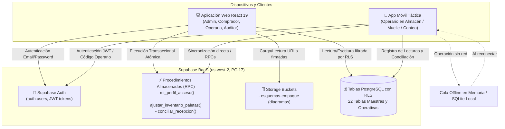
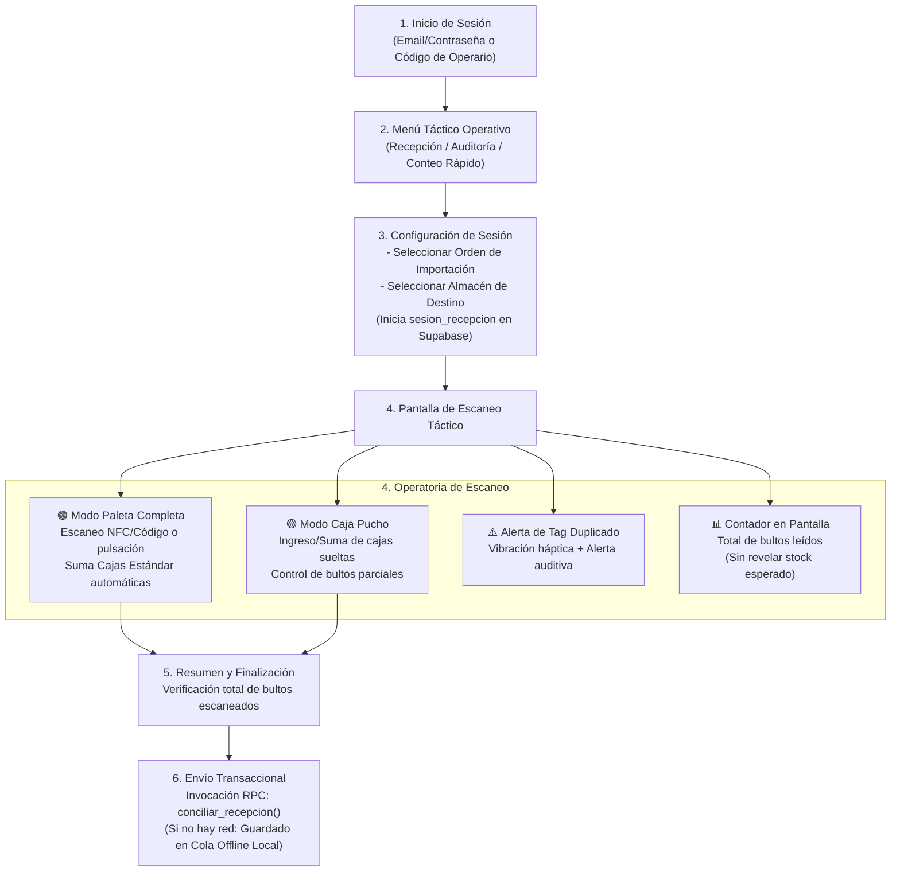

# Contexto Integral del Sistema — Importaciones Shalom (Sistema Táctico)

> **Documento Fuente de Verdad y Memoria Viva del Proyecto**  
> **Última actualización:** 2026-10-09  
> **Versión del Contexto:** 1.4.0  
> **Repositorio:** `Importaciones_shalom`  
> **Proyecto Supabase ID:** `pzsxzzfrwpamjkyyjodj` (Región: `us-west-2`, PostgreSQL 17.6)

---

## 📌 Regla de Oro de Mantenimiento Obligatorio

> [!IMPORTANT]
> **REGLA PARA DESARROLLADORES Y ASISTENTES IA:**  
> Cada vez que se cree, modifique o elimine un componente, vista, endpoint, función RPC, política RLS o tabla en la base de datos, **este archivo (`CONTEXTO_SISTEMA.md`) DEBE ser actualizado inmediatamente** en la sección correspondiente del módulo afectado y en el historial de versiones (Changelog al final del documento). Esto garantiza que cualquier persona o IA cuente siempre con el contexto exacto y actualizado del sistema sin alucinaciones.

---

## 1. Visión General del Proyecto

### 1.1 Misión y Propósito
**Importaciones Shalom · Sistema Táctico de Inventarios y Recepción** es una plataforma integral de gestión logística, trazabilidad de existencias y control de operaciones de importación diseñada para combinar:
1. **Frontend Web React (TypeScript + Vite):** Panel administrativo, comercial y operativo de alto rendimiento, optimizado con interfaz de contraste táctico para la gestión central de catálogos, cubicajes, almacenes y auditorías.
2. **Aplicación Móvil Táctica de Operaciones:** Aplicación para smartphones o terminales móviles de mano utilizada por los operarios en muelle y almacén. Reemplaza el microcontrolador físico externo por escaneo táctil, NFC/cámara integrada o lectores acoplables, manteniendo exactamente el **mismo mapa de navegación y flujo de trabajo**, con capacidad de cola offline para operar sin conexión a internet.
3. **Backend y Base de Datos (Supabase / PostgreSQL 17):** Persistencia en la nube protegida mediante **Row Level Security (RLS)**, control de acceso basado en roles (**RBAC**), funciones transaccionales atómicas (**RPC**) y almacenamiento de fichas técnicas en **Supabase Storage**.

### 1.2 Problema Central que Resuelve
- **Control de estiba y volumen:** Distinción precisa entre **Paletas Completas** ($Cajas = Cajas/Camada \times Camadas$) y **Cajas Sueltas (Puchos)**, impidiendo pérdidas de stock o cálculos erróneos de cubicaje.
- **Recepción en almacén sin ceguera:** Verificación automática de packing lists vs. mercancía física registrada por la app móvil, generando conciliaciones ciegas (detección inmediata de sobrantes y faltantes).
- **Exactitud de Registro de Inventario (ERI):** Auditorías cíclicas con cálculo porcentual de exactitud contra existencias contables.
- **Proyecciones de Importación Basadas en Demanda Real:** Planificación de compras a partir de consumos históricos validados (sin sesgar meses con demanda en cero).

### 1.3 Stack Tecnológico

| Capa | Tecnologías | Notas |
|---|---|---|
| **Frontend Web** | React 19, TypeScript ~6.0, Vite 8 | Sistema de diseño estandarizado (`skill_design.md`), tipografía Barlow Semi Condensed + Source Sans 3, sidebar fijo de 220 px, paleta de tokens precisos, persistencia de tema (`theme.tsx`, `ThemeToggle.tsx`) |
| **App Móvil Operativa** | `Importaciones/shalom_movil` (Expo 57 / React Native) | Terminal operativo Android con sensor NFC integrado (13.56 MHz), cola offline local (AsyncStorage/SQLite) y respuesta háptica |
| **Linter & Build** | Oxlint 1.79, `tsc -b` | Compilación ultra-rápida en modo estricto |
| **BaaS / Backend** | Supabase JS Client (`@supabase/supabase-js` 2.112.4) | Autenticación, PostgreSQL 17, Storage, Triggers, RPCs |
| **Seguridad de BD** | PostgreSQL Row Level Security (RLS) + RBAC | Validación de roles mediante funciones `tiene_rol()` y `es_administrador()` |

### 1.4 Sistema de Diseño Visual Oficial (`skill_design.md`)
Toda vista nueva o existente en el frontend web sigue de forma estricta los lineamientos visuales del archivo maestro `skill_design.md`:

- **Tokens de Color:**
  - `--color-canvas`: `#F2F6F8` (fondo principal de la aplicación)
  - `--color-surface`: `#FFFFFF` (paneles, tablas, formularios, tarjetas y modales)
  - `--color-brand-deep`: `#123D4A` (sidebar fijo de 220 px, encabezados fuertes)
  - `--color-brand`: `#167D8D` (botones primarios, elementos activos, enlaces)
  - `--color-brand-soft`: `#E4F1F3` (filas seleccionadas, estados focus, resaltados sutiles)
  - `--color-text-primary`: `#123D4A` (texto principal y títulos)
  - `--color-text-secondary`: `#627985` (descripciones, metadatos, cabeceras de tablas)
  - `--color-border`: `#D8E3E7` (bordes estructurales e inputs)
  - `--color-warning`: `#BC791F` (atención operativa: stock bajo, validaciones)
  - `--color-danger`: `#B3402A` (acciones destructivas, quiebres de stock)
  - `--color-success`: `#2F7D4F` (estados positivos o completados)
- **Tipografía:**
  - Display y Encabezados: `Barlow Semi Condensed` (semibold 600; títulos de página 28–32 px, sección 20–24 px).
  - Cuerpo, Tablas, Controles: `Source Sans 3` (regular 400, 14–16 px, botones 14–15 px medium).
  - Regla obligatoria: Siempre *sentence case*; nunca utilizar ALL CAPS en cabeceras de tablas, navegación o etiquetas.
  - Encabezados alineados a la izquierda y sin cursivas.
- **Sistema de Layout:**
  - Barra lateral fija (Sidebar): 220 px de ancho, fondo `--color-brand-deep`, texto blanco/claro, con menú jerárquico y tarjeta de usuario/cierre de sesión al pie.
  - Cabecera: Migas de pan (*breadcrumb*), estado de sincronización y selector de tema.
  - Espacio de trabajo (*Workspace*): Fondo `--color-canvas`, superficies en `--color-surface`, espaciado de 16–24 px y sin sombras decorativas pesadas.
- **Patrón Overview (DashboardPage):**
  - Tira horizontal de indicadores clave (4–6) con mismo peso visual.
  - Panel "Atención requerida" priorizado por criticidad operativa con botón directo a la acción.
  - Tarjetas uniformes de resumen por módulo.

---

## 2. Arquitectura General y Flujo de Datos



---

## 3. Matriz de Roles y Niveles de Acceso (RBAC)

La plataforma cuenta con 4 roles base administrados en la tabla `public.rol`:

| Rol | Código Enum | Alcance y Responsabilidad Principal |
|---|---|---|
| **ADMINISTRADOR** | `ADMINISTRADOR` | Control total del sistema: gestión de usuarios, roles, catálogo, almacenes, inventario, auditorías y configuración. |
| **COMPRADOR** | `COMPRADOR` | Gestión comercial: órdenes de importación, evaluación OTIF de proveedores, catálogo de productos y proyección de compras. |
| **OPERARIO** | `OPERARIO` | Operación de campo: recepción móvil de paletas y puchos, ajustes de existencias y escaneo en muelle y almacén. |
| **AUDITOR** | `AUDITOR` | Supervisión y control: auditorías ERI (Exactitud de Registro), conciliación ciega e inspección de movimientos sin permiso de alteración de compras. |

---

## 4. Desglose Módulo por Módulo y Conexiones con Supabase

```
Módulos del Sistema:
├── Módulo 0: Autenticación, Seguridad y Perfil (Base Transversal)
├── Módulo 1 (MOD-01): Maestros y Empaque
├── Módulo 2 (MOD-02): Inventario, Almacenes y Kardex
├── Módulo 3 (MOD-03): Compras e Importaciones
├── Módulo 4 (MOD-04): Recepción Táctica y App Móvil
├── Módulo 5 (MOD-05): Auditorías ERI y Conciliación Ciega
└── Módulo 6 (MOD-06): Administración de Usuarios y Auditoría Global
```

---

### 🔑 Módulo 0: Autenticación, Sesión y RBAC

#### 1. Propósito
Proporcionar inicio de sesión seguro mediante correo y contraseña o código rápido de operario, validación de estado activo del usuario, consulta en tiempo real del perfil logístico con sus roles asignados y bloqueo por RLS en Postgres según claims del token JWT.

#### 2. Componentes Frontend Involucrados
- [`src/auth/AuthProvider.tsx`](file:///home/ludam/Importaciones/Importaciones_shalom/src/auth/AuthProvider.tsx): Contexto `useAuth`, escucha `onAuthStateChange`, invoca `mi_perfil_acceso()`.
- [`src/pages/LoginPage.tsx`](file:///home/ludam/Importaciones/Importaciones_shalom/src/pages/LoginPage.tsx): Formulario de login, gestión de credenciales y mensajes de error.
- [`src/lib/roles.ts`](file:///home/ludam/Importaciones/Importaciones_shalom/src/lib/roles.ts): Función `canAccess(profile, permission, fallbackRoles)` y matriz de permisos.
- [`src/lib/supabase.ts`](file:///home/ludam/Importaciones/Importaciones_shalom/src/lib/supabase.ts): Inicialización del cliente Supabase con persistencia de sesión local.

#### 3. Conexiones con Supabase
- **Tablas:**
  - `public.usuario`: Vincula `auth.users.id` con `auth_user_id`, datos de contacto y `codigo_operario`.
  - `public.rol`: Catálogo de los 4 roles del sistema.
  - `public.usuario_rol`: Asignación N:M de roles a usuarios.
  - `public.permiso` y `public.rol_permiso`: Granularidad fina de acciones (`VER`, `CREAR`, `EDITAR`, `ELIMINAR`).
- **Funciones RPC:**
  - `public.mi_perfil_acceso()`: Función `SECURITY DEFINER` que obtiene nombre, lista de roles (`roles[]`) y permisos (`permisos[]`) del usuario en sesión (`auth.uid()`).
  - `public.tiene_rol(roles_permitidos text[])`: Valida si el usuario actual posee al menos uno de los roles solicitados (núcleo de las políticas RLS).
  - `public.es_administrador()`: Shortcut booleano para validar el rol `ADMINISTRADOR`.
- **Estado Actual:** ✅ **Operativo al 100% en Web y Base de Datos**.

---

### 📦 Módulo 1 (MOD-01): Maestros y Empaque

#### 1. Propósito
Gestión centralizada del catálogo de productos, categorización, especificaciones físicas de empaque (dimensiones de caja, pesos, cubicaje $m^3$), esquemas de estibado por camada/paleta, gestión de proveedores y subida masiva de datos vía CSV.

#### 2. Componentes Frontend Involucrados
- [`src/pages/ProductsPage.tsx`](file:///home/ludam/Importaciones/Importaciones_shalom/src/pages/ProductsPage.tsx): Contenedor principal con pestañas:
  - Subvista Productos y Empaque: [`src/pages/products/subviews/ProductsSubView.tsx`](file:///home/ludam/Importaciones/Importaciones_shalom/src/pages/products/subviews/ProductsSubView.tsx)
  - Subvista Categorías: [`src/pages/products/subviews/CategoriesSubView.tsx`](file:///home/ludam/Importaciones/Importaciones_shalom/src/pages/products/subviews/CategoriesSubView.tsx)
  - Subvista Proveedores: [`src/pages/products/subviews/SuppliersSubView.tsx`](file:///home/ludam/Importaciones/Importaciones_shalom/src/pages/products/subviews/SuppliersSubView.tsx)
  - Subvista Importación Masiva: [`src/pages/products/subviews/DataImportSubView.tsx`](file:///home/ludam/Importaciones/Importaciones_shalom/src/pages/products/subviews/DataImportSubView.tsx)
- Modal de Detalle Técnico: [`src/pages/products/ProductDetailModal.tsx`](file:///home/ludam/Importaciones/Importaciones_shalom/src/pages/products/ProductDetailModal.tsx)
- Tipos de Datos: [`src/pages/products/types.ts`](file:///home/ludam/Importaciones/Importaciones_shalom/src/pages/products/types.ts)
- Auditoría de Catálogo: [`src/lib/audit.ts`](file:///home/ludam/Importaciones/Importaciones_shalom/src/lib/audit.ts)

#### 3. Fórmulas de Empaque y Negocio
$$\text{Cajas por Paleta} = \text{Cajas por Camada} \times \text{Número de Camadas}$$
$$\text{Unidades por Paleta} = \text{Cajas por Paleta} \times \text{Unidades por Caja}$$
$$\text{Volumen de Caja } (m^3) = \frac{\text{Largo (cm)} \times \text{Ancho (cm)} \times \text{Alto (cm)}}{1\,000\,000}$$
$$\text{Volumen de Paleta } (m^3) = \text{Volumen de Caja } (m^3) \times \text{Cajas por Paleta}$$

#### 4. Conexiones con Supabase
- **Tablas:**
  - `public.categoria`: `id_categoria` (PK), `nombre`, `descripcion`, `activo`.
  - `public.producto`: `id_producto` (PK), `sku` (Unique), `nombre`, `descripcion`, `id_categoria` (FK), `unidad_medida`, `peso_unitario_kg`, `costo_unitario`, `clasificacion_abc` ('A', 'B', 'C'), `activo`.
  - `public.regla_empaque`: `id_empaque` (PK), `id_producto` (FK Unique), `unidades_por_caja`, `cajas_por_camada`, `numero_camadas`, `largo_caja_cm`, `ancho_caja_cm`, `alto_caja_cm`, `peso_caja_kg`, `volumen_caja_m3`, `volumen_total_m3`, `permite_puchos`, `notas_armado`, `imagen_armado_path`.
  - `public.esquema_camita`: Soporte opcional para esquemas geométricos de estiba.
  - `public.proveedor`: `id_proveedor` (PK), `razon_social`, `calificacion_otif`, `tiempo_lead_time_dias`, `activo`.
  - `public.auditoria_catalogo`: Registro inmutable de cada cambio (INSERT, UPDATE, DELETE).
- **Vistas:**
  - `public.v_productos_empaque`: Unión optimizada de producto con regla de empaque y categoría.
- **Supabase Storage:**
  - Bucket: `esquemas-empaque` (Ruta: `patrones/{id_producto}_{timestamp}.ext`). Genera URLs firmadas (`createSignedUrl(..., 3600)`).
- **Políticas RLS:**
  - Lectura permitida a usuarios autenticados.
  - Creación/Edición/Eliminación restringida a roles `ADMINISTRADOR` y `COMPRADOR`.
- **Estado Actual:** ✅ **Operativo al 100% en Web y Base de Datos**.

---

### 🏢 Módulo 2 (MOD-02): Inventario, Almacenes y Kardex

#### 1. Propósito
Monitoreo de existencias en tiempo real segmentado por almacén físico o lógico, cálculo automático de semáforos de reposición, cubicaje acumulado ocupado vs. capacidad máxima, trazabilidad inmutable de movimientos y ajuste de existencias basado en **Paletas Completas y Puchos**.

#### 2. Componentes Frontend Involucrados
- [`src/pages/InventoryPage.tsx`](file:///home/ludam/Importaciones/Importaciones_shalom/src/pages/InventoryPage.tsx):
  - Selector y filtro por almacén activo.
  - Tarjetas de resumen métrico: Unidades Totales, Paletas Equivalentes, Puchos Sueltos, Volumen en $m^3$ y Capacidad Utilizada (%).
  - Pestaña **Stock Actual**: Tabla de productos con SKU, regla de empaque, semáforo visual (VERDE/AMARILLO/ROJO), botones de ajuste táctico.
  - Pestaña **Kardex / Movimientos**: Historial cronológico con timestamp, tipo de operación, usuario y motivo.
  - Pestaña **Gestión de Almacenes**: CRUD de almacenes (`PRINCIPAL`, `TIENDA`, `MERMA`) con capacidad en $m^3$.
  - Modal Táctico de Ajuste: Ingreso de paletas enteras y cajas sueltas con recálculo dinámico a unidades.

#### 3. Lógica del Semáforo de Reposición
$$\text{Stock Mínimo} = \text{Cajas por Paleta} \times \text{Unidades por Caja} \quad (\text{Equivalente a 1 paleta completa})$$
$$\text{Estado Semáforo} = \begin{cases} \text{ROJO} & \text{si } \text{Stock Real} \le 0 \\ \text{AMARILLO} & \text{si } 0 < \text{Stock Real} \le \text{Stock Mínimo} \\ \text{VERDE} & \text{si } \text{Stock Real} > \text{Stock Mínimo} \end{cases}$$

#### 4. Conexiones con Supabase
- **Tablas:**
  - `public.almacen`: `id_almacen` (PK), `nombre`, `tipo` (`PRINCIPAL`, `TIENDA`, `MERMA`), `capacidad_m3`, `activo`.
  - `public.inventario`: `id_inventario` (PK), `id_producto` (FK), `id_almacen` (FK), `stock_real`, `stock_minimo`, `estado_semaforo` (`VERDE`, `AMARILLO`, `ROJO`), `updated_at`. Constraint único: `(id_producto, id_almacen)`.
  - `public.movimiento`: `id_movimiento` (PK), `id_usuario`, `id_producto`, `tipo` (`INGRESO_COMPLETO`, `INGRESO_PUCHO`, `DESPACHO_COMPLETO`, `RETIRO_PARCIAL`, `AJUSTE`), `cantidad_afectada`, `destino_almacen`, `origen_almacen`, `motivo`, `fecha_hora`.
- **Funciones RPC:**
  - `public.ajustar_inventario_paletas(p_id_producto, p_id_almacen, p_paletas, p_puchos, p_motivo)`:
    - Convierte paletas completas y puchos a unidades exactas mediante la regla de empaque del producto.
    - Ejecuta `UPSERT` en `public.inventario` recalculando el semáforo.
    - Inserta auditoría inmutable en `public.movimiento`.
- **Políticas RLS:**
  - Lectura de almacén e inventario: `ADMINISTRADOR`, `COMPRADOR`, `OPERARIO`, `AUDITOR`.
  - Ajustes de inventario y movimientos: `ADMINISTRADOR` y `OPERARIO`.
  - Gestión estructural de almacenes: Exclusivo `ADMINISTRADOR`.
- **Estado Actual:** ✅ **Operativo al 100% en Web y Base de Datos**.

---

### 🚢 Módulo 3 (MOD-03): Compras e Importaciones

#### 1. Propósito
Planificación y seguimiento de órdenes de importación marítima y terrestre, cubicaje por tipo de contenedor (20FT, 40FT, LCL), cálculo de consumo mensual real y proyección de reposición validada con datos del `Stock_Ledger.xlsx`.

#### 2. Componentes Frontend Involucrados
- Identificado en navegación [`src/pages/DashboardPage.tsx`](file:///home/ludam/Importaciones/Importaciones_shalom/src/pages/DashboardPage.tsx) (Estado actual: "Próximamente").

#### 3. Reglas de Negocio Especificadas en SRS v4
- **Cálculo de Consumo Real:** Exclusión de ajustes contables y conteo estricto de meses sin venta como valor cero (sin eliminar el mes de la media temporal).
- **Cálculo de Contenedores:**
  - Contenedor 20FT: Capacidad útil nominal aprox. $28 - 30\text{ m}^3$.
  - Contenedor 40FT / 40HQ: Capacidad útil nominal aprox. $58 - 68\text{ m}^3$.
- **Clasificación ABC:** Criterio de Pareto sobre costo unitario por rotación acumulada.

#### 4. Conexiones con Supabase
- **Tablas:**
  - `public.proveedor`: `id_proveedor` (PK), `razon_social`, `calificacion_otif`, `tiempo_lead_time_dias`, `activo`.
  - `public.orden_importacion`: `id_orden` (PK), `codigo_orden`, `id_proveedor` (FK), `fecha_embarque`, `fecha_arribo_estimada`, `estado` (`BORRADOR`, `TRANSITO`, `RECIBIDA`), `creado_por` (FK usuario), `created_at`.
  - `public.detalle_orden`: `id_detalle` (PK), `id_orden` (FK), `id_producto` (FK), `cantidad_pedida_unidades`, `costo_unitario`, `notas`.
- **Políticas RLS:**
  - Lectura y Gestión: Roles `ADMINISTRADOR` y `COMPRADOR`.
- **Estado Actual:** 🟡 **Tablas y RLS desplegadas en Supabase. UI Web en fase de diseño.**

---

### 📱 Módulo 4 (MOD-04): Recepción Táctica y App Móvil

#### 1. Propósito y Cambio Arquitectónico Definitivo
La recepción de mercancía y escaneo en muelle y almacén **se realiza a través de la Aplicación Móvil táctica (`Importaciones/shalom_movil`)** en smartphones o colectores Android rugerizados mediante el **sensor NFC integrado (13.56 MHz)**. Queda totalmente descartada la dependencia del hardware físico microcontrolador (ESP32-S3 + MFRC522). La App Móvil ejecuta el flujo de escaneo guiado por proximidad para tags RFID HF (NTAG213 / MIFARE Classic), preservando el mapa de navegación táctico, la lógica de paletas completas vs. puchos, y el flujo de **conciliación ciega** contra Supabase con soporte de cola offline local.

#### 2. Mapa de Navegación y Flujo Operativo de la App Móvil



#### 3. Soporte Offline en la App Móvil
En zonas de muelle o almacén con apantallamiento metálico o sin señal Wi-Fi/celular:
- Las lecturas se encolan localmente en el almacenamiento del dispositivo móvil (SQLite / almacenamiento local seguro).
- Al restablecerse la conectividad, la aplicación sincroniza automáticamente el paquete de lecturas invocando la función RPC `conciliar_recepcion()`.

#### 4. Conexiones con Supabase
- **Tablas:**
  - `public.dispositivo_iot`: Registra los **terminales móviles autorizados** (`id_dispositivo`, `mac_address` o UUID del teléfono, `nombre`, `ubicacion`, `activo`, `last_seen`).
  - `public.etiqueta_rfid`: Identificadores únicos (`uid`) leídos por NFC o escáner móvil, categorizados como `COMPLETO` o `PUCHO`.
  - `public.sesion_recepcion`: `id_sesion` (PK), `id_orden` (FK), `id_almacen` (FK), `id_operario` (FK), `fecha_inicio`, `fecha_fin`, `estado` (`ACTIVA`, `PAUSADA`, `FINALIZADA`).
  - `public.recepcion_lectura`: `id_lectura` (PK), `id_sesion` (FK), `id_etiqueta` (FK), `uid_leido`, `fecha_hora`, `rssi`.
- **Funciones RPC:**
  - `public.conciliar_recepcion(p_id_orden, p_id_producto, p_id_almacen, p_lecturas jsonb)`:
    - Invocada directamente desde la App Móvil.
    - Bloqueo exclusivo `pg_advisory_xact_lock(hashtext('conciliar_recepcion_lock'))`.
    - Procesa el JSON de lecturas de la app: `[{ "uid": "...", "tipo": "COMPLETO"|"PUCHO", "cantidad_paquetes": N }]`.
    - Registra tags, acumula stock en `inventario`, genera `movimiento` y calcula la `conciliacion_ciega`.
- **Políticas RLS:**
  - Permite a `ADMINISTRADOR` y `OPERARIO` crear y consultar sesiones, registrar lecturas y conciliar.
- **Estado Actual:** 🟡 **Base de datos, migraciones 8, 9, 10 y RPCs operativas. Aplicación móvil en desarrollo en el repositorio `/home/ludam/Importaciones/shalom_movil` con su propio `CONTEXTO_SISTEMA.md` y `AGENTS.md` como Fuente de Verdad móvil.**

---

### 🔍 Módulo 5 (MOD-05): Auditorías ERI y Conciliación Ciega

#### 1. Propósito
Supervisión de la exactitud de inventario mediante conteos secuenciales ciegos ejecutados desde la **App Móvil** o la **Plataforma Web**, comparando el stock físico real contra las existencias registradas sin sesgar al auditor.

#### 2. Fórmulas Matemáticas de Auditoría
$$\text{Diferencia} = \text{Cantidad Leída (Física)} - \text{Cantidad Esperada (Teórica)}$$
$$\text{Estado} = \begin{cases} \text{CONFORME / COMPLETA} & \text{si } \text{Diferencia} = 0 \\ \text{SOBRANTE} & \text{si } \text{Diferencia} > 0 \\ \text{FALTANTE} & \text{si } \text{Diferencia} < 0 \end{cases}$$
$$\text{ERI (\%)} = \left( \frac{\text{Número de SKUs con } |\text{Diferencia}| \le \text{Tolerancia}}{\text{Total de SKUs Auditados}} \right) \times 100\%$$

#### 3. Conexiones con Supabase
- **Tablas:**
  - `public.conciliacion_ciega`: `id_conciliacion` (PK), `id_sesion` (FK), `id_producto` (FK), `cantidad_esperada`, `cantidad_leida`, `diferencia`, `estado_conciliacion` (`COMPLETA`, `FALTANTES`, `SOBRANTES`), `fecha_conciliacion`.
  - `public.auditoria_eri`: `id_auditoria` (PK), `id_almacen` (FK), `id_auditor` (FK usuario), `fecha_auditoria`, `total_items_auditados`, `items_exactos`, `porcentaje_eri`, `observaciones`.
- **Funciones RPC:**
  - `public.poblar_conciliacion_ciega(p_id_sesion bigint)`: Genera las líneas de conciliación comparando lo escaneado con la orden.
- **Políticas RLS:**
  - Consulta y ejecución: Roles `ADMINISTRADOR` y `AUDITOR`.
- **Estado Actual:** 🟡 **Estructura en base de datos completada; interfaz visual en desarrollo.**

---

### 🛡️ Módulo 6 (MOD-06): Administración de Usuarios y Seguridad Global

#### 1. Propósito
Gestión de usuarios del sistema, asignación de roles operativos, códigos de operario para autenticación rápida en la app móvil y bitácora de auditoría forense para modificaciones de catálogo.

#### 2. Componentes Frontend Involucrados
- [`src/lib/audit.ts`](file:///home/ludam/Importaciones/Importaciones_shalom/src/lib/audit.ts): Función utilitaria `logCatalogChange` que registra `INSERT`, `UPDATE` o `DELETE` con snapshots `datos_anteriores` y `datos_nuevos`.
- Pantalla de bienvenida / Dashboard: [`src/pages/DashboardPage.tsx`](file:///home/ludam/Importaciones/Importaciones_shalom/src/pages/DashboardPage.tsx).

#### 3. Conexiones con Supabase
- **Tablas:**
  - `public.usuario`: Perfiles asociados a cuentas de `auth.users`.
  - `public.rol`: Catálogo de 4 roles del sistema.
  - `public.usuario_rol`: Asignaciones de roles por usuario.
  - `public.permiso` y `public.rol_permiso`: Permisos específicos por módulo y acción.
  - `public.auditoria_catalogo`: `id_auditoria` (PK), `tabla`, `operacion`, `id_registro`, `auth_user_id`, `datos_anteriores` (jsonb), `datos_nuevos` (jsonb), `created_at`.
- **Políticas RLS:**
  - Exclusivo para rol `ADMINISTRADOR`.
- **Estado Actual:** ✅ **Modelo activo y auditoría transversal operativa; UI gráfica de administración de usuarios en desarrollo.**

---

## 5. Resumen de Tablas y Objetos de Base de Datos en Supabase

| Tabla / Objeto | Tipo | Módulo | Acceso RLS Lectura | Acceso RLS Escritura |
|---|---|---|---|---|
| `rol` | Tabla | Módulo 0 | Autenticado | Solo Admin |
| `permiso` | Tabla | Módulo 0 | Autenticado | Solo Admin |
| `rol_permiso` | Tabla | Módulo 0 | Autenticado | Solo Admin |
| `usuario` | Tabla | Módulo 0 / 6 | Autenticado | Solo Admin |
| `usuario_rol` | Tabla | Módulo 0 / 6 | Autenticado | Solo Admin |
| `categoria` | Tabla | Módulo 1 | Autenticado | Admin, Comprador |
| `producto` | Tabla | Módulo 1 | Autenticado | Admin, Comprador |
| `regla_empaque` | Tabla | Módulo 1 | Autenticado | Admin, Comprador |
| `esquema_camita` | Tabla | Módulo 1 | Autenticado | Admin, Comprador |
| `proveedor` | Tabla | Módulo 1 / 3 | Autenticado | Admin, Comprador |
| `auditoria_catalogo` | Tabla | Módulo 1 / 6 | Solo Admin | Autenticado (Insert vía audit.ts) |
| `v_productos_empaque` | Vista SQL | Módulo 1 | Autenticado | N/A (Solo lectura) |
| `almacen` | Tabla | Módulo 2 | Autenticado | Solo Admin |
| `inventario` | Tabla | Módulo 2 | Admin, Comprador, Operario, Auditor | Admin, Operario |
| `movimiento` | Tabla | Módulo 2 | Admin, Operario, Auditor | Admin, Operario (Solo Insert) |
| `orden_importacion` | Tabla | Módulo 3 | Admin, Comprador | Admin, Comprador |
| `detalle_orden` | Tabla | Módulo 3 | Admin, Comprador | Admin, Comprador |
| `dispositivo_iot` | Tabla | Módulo 4 | Admin, Operario | Solo Admin (Terminales móviles autorizados) |
| `etiqueta_rfid` | Tabla | Módulo 4 | Autenticado | Admin, Operario (Tags NFC/RFID móviles) |
| `sesion_recepcion` | Tabla | Módulo 4 | Autenticado | Admin, Operario |
| `recepcion_lectura` | Tabla | Módulo 4 | Autenticado | Admin, Operario |
| `conciliacion_ciega` | Tabla | Módulo 4 / 5 | Autenticado | Admin, Operario, Auditor |
| `auditoria_eri` | Tabla | Módulo 5 | Autenticado | Admin, Auditor |
| `esquemas-empaque` | Storage Bucket | Módulo 1 | Autenticado (URLs firmadas) | Admin, Comprador |

---

## 6. Procedimientos Almacenados (RPC) de Supabase

### 1. `mi_perfil_acceso()`
- **Parámetros:** Ninguno (utiliza internamente `auth.uid()`).
- **Retorno:** `TABLE (nombre_completo text, roles text[], permisos text[])`.
- **Propósito:** Carga inmediata de la identidad del usuario y sus permisos al iniciar sesión.

### 2. `tiene_rol(roles_permitidos text[])`
- **Parámetros:** `roles_permitidos text[]`.
- **Retorno:** `boolean`.
- **Propósito:** Utilizado internamente por las políticas RLS para permitir o denegar SELECT/INSERT/UPDATE/DELETE.

### 3. `es_administrador()`
- **Parámetros:** Ninguno.
- **Retorno:** `boolean`.
- **Propósito:** Comprueba si el usuario tiene asignado el rol `ADMINISTRADOR`.

### 4. `ajustar_inventario_paletas(p_id_producto, p_id_almacen, p_paletas, p_puchos, p_motivo)`
- **Parámetros:**
  - `p_id_producto` (`bigint`)
  - `p_id_almacen` (`bigint`)
  - `p_paletas` (`integer`)
  - `p_puchos` (`integer`)
  - `p_motivo` (`text`, default: `'Ajuste manual de inventario'`)
- **Retorno:** `jsonb` con detalle del stock resultante y stock previo.
- **Propósito:** Convierte bultos físicos a unidades de inventario, actualiza el semáforo y registra la transacción inmutable en `movimiento`.

### 5. `conciliar_recepcion(p_id_orden, p_id_producto, p_id_almacen, p_lecturas)`
- **Parámetros:**
  - `p_id_orden` (`bigint`)
  - `p_id_producto` (`bigint`)
  - `p_id_almacen` (`bigint`)
  - `p_lecturas` (`jsonb`): Lista de tags escaneados por la App Móvil o la web (`[{"uid":"...","tipo":"COMPLETO"|"PUCHO","cantidad_paquetes":N}]`).
- **Retorno:** `jsonb` con estado de la conciliación (`COMPLETA`, `FALTANTES`, `SOBRANTES`), unidades recibidas y diferencias.
- **Propósito:** Cierra la recepción física blindada por un cerrojo transaccional advisory lock.

---

## 7. Protocolo Obligatorio para Mantener este Archivo Actualizado

Cualquier agente inteligente o desarrollador humano que realice modificaciones en el repositorio debe seguir este checklist antes de dar por terminada su tarea:

1. **¿Se creó o modificó un archivo en `src/` o en la app móvil?**
   - Si pertenece a un módulo existente, actualiza la sección **2. Componentes Frontend Involucrados** del módulo correspondiente.
   - Si crea una nueva vista o módulo, añade la sección respectiva numerada.
2. **¿Se modificaron tablas, columnas, RLS o RPCs en `supabase/`?**
   - Actualiza la sección **Conexiones con Supabase** del módulo respectivo.
   - Actualiza la **Tabla de Resumen (Sección 5)** y la sección de **Procedimientos Almacenados (Sección 6)**.
3. **¿Se actualizaron dependencias o variables de entorno?**
   - Reflejar en la sección de **Stack Tecnológico (Sección 1.3)** o en `.env.example`.
4. **Registrar el cambio en el Changelog:**
   - Añadir una nueva entrada en la sección 8 con fecha, autor/agente y resumen conciso de los cambios.

---

## 8. Historial de Versiones del Contexto (Changelog)

| Versión | Fecha | Autor | Cambios Principales |
|---|---|---|---|
| **1.4.0** | 2026-10-09 | Antigravity AI | **Adopción Oficial de `skill_design.md` y Arquitectura Modular UI:**<br>1. **Tipografía Oficial:** Inclusión de Google Fonts para `Barlow Semi Condensed` (títulos y display, 28–32px) y `Source Sans 3` (cuerpo, tablas, controles, botones) en `index.html` e `index.css`.<br>2. **Tokens de Color y Limpieza de Sombras:** Estandarización de `--color-canvas: #F2F6F8`, `--color-surface: #FFFFFF`, `--color-brand-deep: #123D4A`, `--color-brand: #167D8D`, `--color-brand-soft: #E4F1F3`, `--color-border: #D8E3E7`, `--color-warning: #BC791F`, `--color-danger: #B3402A`, `--color-success: #2F7D4F`. Eliminación de sombras decorativas pesadas y gradientes.<br>3. **Layout con Sidebar 220px:** Reemplazo de topbar aislado por un Layout maestro (`App.tsx`) con barra lateral fija de 220 px (`--color-brand-deep`), scrollable y escalable, información del usuario al pie y cabecera superior con breadcrumbs y selector de contexto.<br>4. **Patrón de Overview (DashboardPage):** Implementación de tira horizontal de indicadores clave (4–6) enlazados a módulos, panel de atención priorizada ("Atención requerida") y tarjetas uniformes de resumen modular.<br>5. **Regla de Estilo Sentence Case:** Normalización de etiquetas, navegación y cabeceras de tablas a sentence case (sin ALL CAPS).<br>6. **Memoria y Protocolos Permanentes:** Registro del diseño en `AGENTS.md`, `.cursorrules` y `.agents/rules/skill_design.md` para garantizar consistencia en todas las vistas futuras. |
| **1.3.0** | 2026-10-09 | Antigravity AI | **Rediseño Integral (Directrices `skill_design.md`), Soporte de Modo Oscuro/Claro y Migración a Móvil NFC:**<br>1. **Rediseño Frontend:** Eliminación total del tema Spider-Man/neón/eyebrows clichés en `src/index.css`, `App.tsx`, `LoginPage.tsx`, `DashboardPage.tsx`, `ProductsPage.tsx` e `InventoryPage.tsx`. Adopción del sistema de tokens *Industrial Tactical WMS* (paleta sobria carbón `#0b0f17`, acento ámbar logístico `#d97706`, azul técnico `#38bdf8` para SKUs/RFID, tablas de alta densidad y modales limpios).<br>2. **Soporte Dual Modo Oscuro y Modo Claro:** Implementación de tokens para `[data-theme="light"]` (fondo slate limpio `#f1f5f9`, superficies `#ffffff`, texto de alto contraste `#0f172a`, acentos ajustados) y `[data-theme="dark"]`, proveedor `ThemeProvider` (`src/lib/theme.tsx`) con persistencia en `localStorage` y componente `ThemeToggle` (`src/lib/ThemeToggle.tsx`) en barra superior y pantalla de login.<br>3. **Descarte de ESP32-S3 + RC522:** Actualización integral de la especificación técnica en `SRS_Sistema_RFID_RC522_Modificado_v4.md` (v5.0), migrando formalmente el hardware físico hacia la aplicación móvil táctica `Importaciones/shalom_movil` con sensor NFC integrado (13.56 MHz, ISO/IEC 14443A), respuesta háptica y persistencia offline local en SQLite. |
| **1.2.0** | 2026-10-03 | Antigravity AI | **Sincronización de Fuente de Verdad para App Móvil (`shalom_movil`):** Creación de `CONTEXTO_SISTEMA.md` y actualización de `AGENTS.md` en el repositorio hermano `/home/ludam/Importaciones/shalom_movil`. Se documenta formalmente la arquitectura táctica móvil en Expo 57, los 7 flujos de escaneo de `mapa_de_navegacion.txt`, la cola offline en `AsyncStorage` y la conexión con Supabase. |
| **1.1.0** | 2026-10-03 | Antigravity AI | **Pivote arquitectónico:** sustitución del hardware físico IoT (ESP32-S3 + MFRC522) por una **Aplicación Móvil táctica** para operarios. Se preserva íntegro el mapa de navegación operativa (Login -> Selección Orden/Almacén -> Escaneo Paletas/Puchos -> Conciliación Ciega con RPC `conciliar_recepcion`) y el soporte de sincronización con cola offline. |
| **1.0.0** | 2026-10-03 | Antigravity AI | Creación inicial del documento maestro de contexto consolidado: mapeo de todos los módulos (0 al 6), esquemas de Supabase, fórmulas de empaque y reglas de sincronización continua. |
