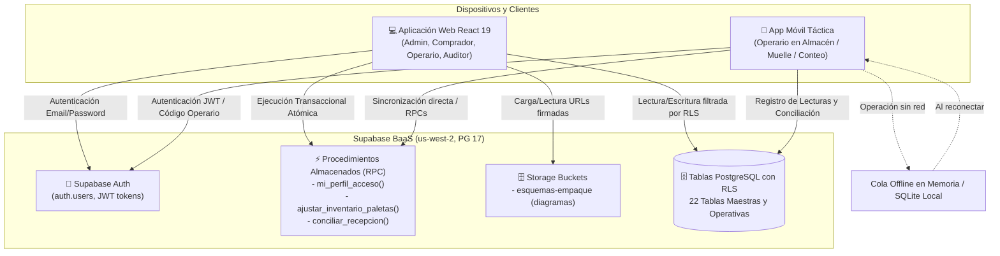
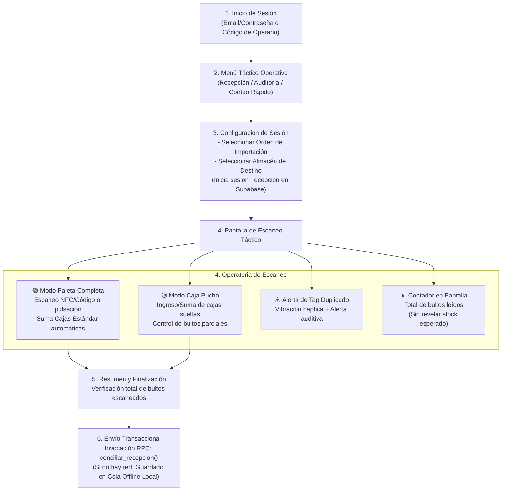

# Contexto Integral del Sistema — Importaciones Shalom (Sistema Táctico)

> **Documento Fuente de Verdad y Memoria Viva del Proyecto**  
> **Última actualización:** 2026-10-15  
> **Versión del Contexto:** 1.7.1  
> **Repositorio:** `Importaciones_shalom`  
> **Proyecto Supabase ID:** `pzsxzzfrwpamjkyyjodj` (Región: `us-west-2`, PostgreSQL 17.6)

---

## 📌 Regla de Oro de Mantenimiento Obligatorio

> [!IMPORTANT]
> **REGLA PARA DESARROLLADORES Y ASISTENTES IA:**  
> Cada vez que se cree, modifique o elimine un componente, vista, endpoint, función RPC, política RLS o tabla en la base de datos, **este archivo (`CONTEXTO_SISTEMA.md`) DEBE ser actualizado inmediatamente** en la sección correspondiente del módulo afectado y en el historial de versiones (Changelog al final del documento). Esto garantiza que cualquier persona o IA cuente siempre con el contexto exacto y actualizado del sistema sin alucinaciones.

---

## 1. Visión General del Proyecto

### 1.1 Misión y Propósito
**Importaciones Shalom · Sistema Táctico de Inventarios y Recepción** es una plataforma integral de gestión logística, trazabilidad de existencias y control de operaciones de importación diseñada para combinar:
1. **Frontend Web React (TypeScript + Vite):** Panel administrativo, comercial y operativo de alto rendimiento, optimizado con interfaz de contraste táctico para la gestión central de catálogos, cubicajes, almacenes y auditorías.
2. **Aplicación Móvil Táctica de Operaciones:** Aplicación para smartphones o terminales móviles de mano utilizada por los operarios en muelle y almacén. Reemplaza el microcontrolador físico externo por escaneo táctil, NFC/cámara integrada o lectores acoplables, manteniendo exactamente el **mismo mapa de navegación y flujo de trabajo**, con capacidad de cola offline para operar sin conexión a internet.
3. **Backend y Base de Datos (Supabase / PostgreSQL 17):** Persistencia en la nube protegida mediante **Row Level Security (RLS)**, control de acceso basado en roles (**RBAC**), funciones transaccionales atómicas (**RPC**) y almacenamiento de fichas técnicas en **Supabase Storage**.

### 1.2 Problema Central que Resuelve
- **Control de estiba y volumen:** Distinción precisa entre **Paletas Completas** ($Cajas = Cajas/Camada \times Camadas$) y **Cajas Sueltas (Puchos)**, impidiendo pérdidas de stock o cálculos erróneos de cubicaje.
- **Recepción en almacén sin ceguera:** Verificación automática de packing lists vs. mercancía física registrada por la app móvil, generando conciliaciones ciegas (detección inmediata de sobrantes y faltantes).
- **Exactitud de Registro de Inventario (ERI):** Auditorías cíclicas con cálculo porcentual de exactitud contra existencias contables.
- **Proyecciones de Importación Basadas en Demanda Real:** Planificación de compras a partir de consumos históricos validados (sin sesgar meses con demanda en cero).

### 1.3 Stack Tecnológico

| Capa | Tecnologías | Notas |
|---|---|---|
| **Frontend Web** | React 19, TypeScript ~6.0, Vite 8 | Sistema de diseño estandarizado (`skill_design.md`), tipografía Barlow Semi Condensed + Source Sans 3, sidebar fijo de 220 px, paleta de tokens precisos, persistencia de tema (`theme.tsx`, `ThemeToggle.tsx`) |
| **App Móvil Operativa** | `Importaciones/shalom_movil` (Expo 57 / React Native) | Terminal operativo Android con sensor NFC integrado (13.56 MHz), cola offline local (AsyncStorage/SQLite) y respuesta háptica |
| **Linter & Build** | Oxlint 1.79, `tsc -b` | Compilación ultra-rápida en modo estricto |
| **BaaS / Backend** | Supabase JS Client (`@supabase/supabase-js` 2.112.4) | Autenticación, PostgreSQL 17, Storage, Triggers, RPCs |
| **Seguridad de BD** | PostgreSQL Row Level Security (RLS) + RBAC | Validación de roles mediante funciones `tiene_rol()` y `es_administrador()` |

### 1.4 Sistema de Diseño Visual Oficial (`skill_design.md`)
Toda vista nueva o existente en el frontend web sigue de forma estricta los lineamientos visuales del archivo maestro `skill_design.md`:

- **Tokens de Color:**
  - `--color-canvas`: `#F2F6F8` (fondo principal de la aplicación)
  - `--color-surface`: `#FFFFFF` (paneles, tablas, formularios, tarjetas y modales)
  - `--color-brand-deep`: `#123D4A` (sidebar fijo de 220 px, encabezados fuertes)
  - `--color-brand`: `#167D8D` (botones primarios, elementos activos, enlaces)
  - `--color-brand-soft`: `#E4F1F3` (filas seleccionadas, estados focus, resaltados sutiles)
  - `--color-text-primary`: `#123D4A` (texto principal y títulos)
  - `--color-text-secondary`: `#627985` (descripciones, metadatos, cabeceras de tablas)
  - `--color-border`: `#D8E3E7` (bordes estructurales e inputs)
  - `--color-warning`: `#BC791F` (atención operativa: stock bajo, validaciones)
  - `--color-danger`: `#B3402A` (acciones destructivas, quiebres de stock)
  - `--color-success`: `#2F7D4F` (estados positivos o completados)
- **Tipografía:**
  - Display y Encabezados: `Barlow Semi Condensed` (semibold 600; títulos de página 28–32 px, sección 20–24 px).
  - Cuerpo, Tablas, Controles: `Source Sans 3` (regular 400, 14–16 px, botones 14–15 px medium).
  - Regla obligatoria: Siempre *sentence case*; nunca utilizar ALL CAPS en cabeceras de tablas, navegación o etiquetas.
  - Encabezados alineados a la izquierda y sin cursivas.
- **Sistema de Layout:**
  - Barra lateral fija (Sidebar): 220 px de ancho, fondo `--color-brand-deep`, texto blanco/claro, con menú jerárquico y tarjeta de usuario/cierre de sesión al pie.
  - Cabecera: Migas de pan (*breadcrumb*), estado de sincronización y selector de tema.
  - Espacio de trabajo (*Workspace*): Fondo `--color-canvas`, superficies en `--color-surface`, espaciado de 16–24 px y sin sombras decorativas pesadas.
- **Patrón Overview (DashboardPage):**
  - Tira horizontal de indicadores clave (4–6) con mismo peso visual.
  - Panel "Atención requerida" priorizado por criticidad operativa con botón directo a la acción.
  - Tarjetas uniformes de resumen por módulo.

---

## 2. Arquitectura General y Flujo de Datos



---

## 3. Matriz de Roles y Niveles de Acceso (RBAC)

La plataforma cuenta con 4 roles base administrados en la tabla `public.rol`:

| Rol | Código Enum | Alcance y Responsabilidad Principal |
|---|---|---|
| **ADMINISTRADOR** | `ADMINISTRADOR` | Control total del sistema: gestión de usuarios, roles, catálogo, almacenes, inventario, auditorías y configuración. |
| **COMPRADOR** | `COMPRADOR` | Gestión comercial: órdenes de importación, evaluación OTIF de proveedores, catálogo de productos y proyección de compras. |
| **OPERARIO** | `OPERARIO` | Operación de campo: recepción móvil de paletas y puchos, ajustes de existencias y escaneo en muelle y almacén. |
| **AUDITOR** | `AUDITOR` | Supervisión y control: auditorías ERI (Exactitud de Registro), conciliación ciega e inspección de movimientos sin permiso de alteración de compras. |

---

## 4. Desglose Módulo por Módulo y Conexiones con Supabase

```
Módulos del Sistema (Mapa Oficial de 8 Módulos):
├── Módulo 0: Autenticación, Seguridad y Perfil (Base Transversal)
├── Módulo 1 (MOD-01): Maestros y empaque
├── Módulo 2 (MOD-02): Inventario y almacenes
├── Módulo 3 (MOD-03): Movimientos y transferencias (Operativo)
├── Módulo 4 (MOD-04): Recepciones RFID (Mercadería nueva)
├── Módulo 5 (MOD-05): Auditorías RFID (ERI)
├── Módulo 6 (MOD-06): Órdenes y proyecciones de importación
├── Módulo 7 (MOD-07): Control de contenedores
└── Módulo 8 (MOD-08): Usuarios y permisos
```

---

### 🔑 Módulo 0: Autenticación, Sesión y RBAC

#### 1. Propósito
Proporcionar inicio de sesión seguro mediante correo y contraseña o código rápido de operario, validación de estado activo del usuario, consulta en tiempo real del perfil logístico con sus roles asignados y bloqueo por RLS en Postgres según claims del token JWT.

#### 2. Componentes Frontend Involucrados
- [`src/auth/AuthProvider.tsx`](file:///home/ludam/Importaciones/Importaciones_shalom/src/auth/AuthProvider.tsx): Contexto `useAuth`, escucha `onAuthStateChange`, invoca `mi_perfil_acceso()`.
- [`src/pages/LoginPage.tsx`](file:///home/ludam/Importaciones/Importaciones_shalom/src/pages/LoginPage.tsx): Formulario de login, gestión de credenciales y mensajes de error.
- [`src/lib/roles.ts`](file:///home/ludam/Importaciones/Importaciones_shalom/src/lib/roles.ts): Función `canAccess(profile, permission, fallbackRoles)` y matriz de permisos.
- [`src/lib/supabase.ts`](file:///home/ludam/Importaciones/Importaciones_shalom/src/lib/supabase.ts): Inicialización del cliente Supabase con persistencia de sesión local.

#### 3. Conexiones con Supabase
- **Tablas:**
  - `public.usuario`: Vincula `auth.users.id` con `auth_user_id`, datos de contacto y `codigo_operario`.
  - `public.rol`: Catálogo de los 4 roles del sistema.
  - `public.usuario_rol`: Asignación N:M de roles a usuarios.
  - `public.permiso` y `public.rol_permiso`: Granularidad fina de acciones (`VER`, `CREAR`, `EDITAR`, `ELIMINAR`).
- **Funciones RPC:**
  - `public.mi_perfil_acceso()`: Función `SECURITY DEFINER` que obtiene nombre, lista de roles (`roles[]`) y permisos (`permisos[]`) del usuario en sesión (`auth.uid()`).
  - `public.tiene_rol(roles_permitidos text[])`: Valida si el usuario actual posee al menos uno de los roles solicitados (núcleo de las políticas RLS).
  - `public.es_administrador()`: Shortcut booleano para validar el rol `ADMINISTRADOR`.
- **Estado Actual:** ✅ **Operativo al 100% en Web y Base de Datos**.

---

### 📦 Módulo 1 (MOD-01): Maestros y Empaque

#### 1. Propósito
Gestión centralizada del catálogo de productos, categorización, especificaciones físicas de empaque (dimensiones de caja, pesos, cubicaje $m^3$), esquemas de estibado por camada/paleta, gestión de proveedores y subida masiva de datos vía CSV.

#### 2. Componentes Frontend Involucrados
- [`src/pages/ProductsPage.tsx`](file:///home/ludam/Importaciones/Importaciones_shalom/src/pages/ProductsPage.tsx): Contenedor principal con pestañas:
  - Subvista Productos y Empaque: [`src/pages/products/subviews/ProductsSubView.tsx`](file:///home/ludam/Importaciones/Importaciones_shalom/src/pages/products/subviews/ProductsSubView.tsx)
  - Subvista Categorías: [`src/pages/products/subviews/CategoriesSubView.tsx`](file:///home/ludam/Importaciones/Importaciones_shalom/src/pages/products/subviews/CategoriesSubView.tsx)
  - Subvista Proveedores: [`src/pages/products/subviews/SuppliersSubView.tsx`](file:///home/ludam/Importaciones/Importaciones_shalom/src/pages/products/subviews/SuppliersSubView.tsx)
  - Subvista Importación Masiva: [`src/pages/products/subviews/DataImportSubView.tsx`](file:///home/ludam/Importaciones/Importaciones_shalom/src/pages/products/subviews/DataImportSubView.tsx)
- Modal de Detalle Técnico: [`src/pages/products/ProductDetailModal.tsx`](file:///home/ludam/Importaciones/Importaciones_shalom/src/pages/products/ProductDetailModal.tsx)
- Tipos de Datos: [`src/pages/products/types.ts`](file:///home/ludam/Importaciones/Importaciones_shalom/src/pages/products/types.ts)
- Auditoría de Catálogo: [`src/lib/audit.ts`](file:///home/ludam/Importaciones/Importaciones_shalom/src/lib/audit.ts)

#### 3. Fórmulas de Empaque y Negocio
$$\text{Cajas por Paleta} = \text{Cajas por Camada} \times \text{Número de Camadas}$$
$$\text{Unidades por Paleta} = \text{Cajas por Paleta} \times \text{Unidades por Caja}$$
$$\text{Volumen de Caja } (m^3) = \frac{\text{Largo (cm)} \times \text{Ancho (cm)} \times \text{Alto (cm)}}{1\,000\,000}$$
$$\text{Volumen de Paleta } (m^3) = \text{Volumen de Caja } (m^3) \times \text{Cajas por Paleta}$$

#### 4. Conexiones con Supabase
- **Tablas:**
  - `public.categoria`: `id_categoria` (PK), `nombre`, `descripcion`, `activo`.
  - `public.producto`: `id_producto` (PK), `sku` (Unique), `nombre`, `descripcion`, `id_categoria` (FK), `unidad_medida`, `peso_unitario_kg`, `costo_unitario`, `clasificacion_abc` ('A', 'B', 'C'), `activo`.
  - `public.regla_empaque`: `id_empaque` (PK), `id_producto` (FK Unique), `unidades_por_caja`, `cajas_por_camada`, `numero_camadas`, `largo_caja_cm`, `ancho_caja_cm`, `alto_caja_cm`, `peso_caja_kg`, `volumen_caja_m3`, `volumen_total_m3`, `permite_puchos`, `notas_armado`, `imagen_armado_path`.
  - `public.esquema_camita`: Soporte opcional para esquemas geométricos de estiba.
  - `public.proveedor`: `id_proveedor` (PK), `razon_social`, `calificacion_otif`, `tiempo_lead_time_dias`, `activo`.
  - `public.auditoria_catalogo`: Registro inmutable de cada cambio (INSERT, UPDATE, DELETE).
- **Vistas:**
  - `public.v_productos_empaque`: Unión optimizada de producto con regla de empaque y categoría.
- **Supabase Storage:**
  - Bucket: `esquemas-empaque` (Ruta: `patrones/{id_producto}_{timestamp}.ext`). Genera URLs firmadas (`createSignedUrl(..., 3600)`).
- **Políticas RLS:**
  - Lectura permitida a usuarios autenticados.
  - Creación/Edición/Eliminación restringida a roles `ADMINISTRADOR` y `COMPRADOR`.
- **Estado Actual:** ✅ **Operativo al 100% en Web y Base de Datos**.

---

### 🏢 Módulo 2 (MOD-02): Inventario, Almacenes y Kardex

#### 1. Propósito
Monitoreo de existencias en tiempo real segmentado por almacén físico o lógico, cálculo automático de semáforos de reposición, cubicaje acumulado ocupado vs. capacidad máxima, trazabilidad inmutable de movimientos Kardex y administración física 1:1 de **Paletas Completas y Puchos con Tags RFID**.

#### 2. Componentes Frontend Involucrados
- [`src/pages/InventoryPage.tsx`](file:///home/ludam/Importaciones/Importaciones_shalom/src/pages/InventoryPage.tsx):
  - Selector y filtro táctico de almacenes activos con indicación del prefijo RFID oficial (`TAG: ALMPRI`, `TIECEN`, etc.).
  - **Banner de Alertas Operativas del Sistema:** Panel reactivo en piso conectado a `alerta_sistema` (notificaciones de `PUCHO_COMPLETADO`, etc.) con botón de verificación en un clic.
  - Tarjetas de resumen métrico: Unidades Totales, Paletas Completas Físicas (conteo de `tipo_paleta = 'COMPLETO'`), Paletas Pucho Físicas (conteo de `tipo_paleta = 'PUCHO'`), Volumen en $m^3$ y Capacidad Utilizada (%).
  - Pestaña **Stock Actual**: Tabla de productos con SKU, regla de empaque, columnas de "Paletas Completas" y "Puchos (Cajas)" alimentadas directamente desde `v_conteo_paletas_almacen` / `activePallets` (sustituyendo divisiones teóricas de stock), semáforo visual (VERDE/AMARILLO/ROJO), botones de ajuste táctico, botón directo **"Ingresar Paleta"** y botón **"Paletas físicas (X)"** para inspección y baja inmediata por SKU.
  - Pestaña **Paletas RFID**: Subvista dedicada [`src/pages/inventory/PalletDecommissionSubView.tsx`](file:///home/ludam/Importaciones/Importaciones_shalom/src/pages/inventory/PalletDecommissionSubView.tsx) accesible desde la barra de navegación del módulo (`Paletas RFID (X)`):
    - Búsqueda y filtrado por SKU, tag UID o celda.
    - **Baja Táctica (Estado VACIA):** Invoca la RPC `dar_baja_etiqueta_rfid(p_uid_tag, p_motivo)` o actualiza `estado = 'VACIA'`, restando las unidades exactas de `inventario.stock_real` y asentando Kardex `RETIRO_PARCIAL` o `DESPACHO_COMPLETO`.
    - **Transferencias entre Sedes:** Modal integrado que ejecuta la RPC `transferir_carga_entre_almacenes`, cerrando el tag en origen (`VACIA`), descontando stock en origen, unificando puchos en destino si completan una paleta estándar (`PUCHO_COMPLETADO`) e incrementando stock en destino.
  - Pestaña **Racks y Ubicaciones**: Subvista táctica interactiva [`src/pages/inventory/RackLocationsSubView.tsx`](file:///home/ludam/Importaciones/Importaciones_shalom/src/pages/inventory/RackLocationsSubView.tsx) con elevación gráfica de túneles Drive-In (LIFO) con $N$ niveles asimétricos configurables, visor de celdas libres/ocupadas con botón de baja en cada casilla, y panel de **Zona de Campo / Piso Libre** para bultos sobredimensionados.
  - Pestaña **Kardex / Movimientos**: Historial cronológico inmutable con timestamp, tipo de operación (`INGRESO_COMPLETO`, `INGRESO_PUCHO`, `DESPACHO_COMPLETO`, `RETIRO_PARCIAL`), usuario y motivo.
  - Pestaña **Gestión de Almacenes**: CRUD de almacenes (`PRINCIPAL`, `TIENDA`, `MERMA`) con capacidad en $m^3$ y prefijo oficial de tag RFID.
  - **Modal Táctico de Enrolamiento RFID / Ajuste**:
    - **Modo RFID (Manual Web):** Permite ingresar a mano el código alfanumérico leído físicamente del tag RFID (o pistola USB) o presionar el botón asistido **`⚡ Sugerir ({prefijo})`** para generar el siguiente código secuencial según `secuencia_rfid`, código de barras opcional, tipo de carga (Completa vs Pucho), cajas y motivo. Si el tag estaba `'VACIA'`, lo reactiva a `'ACTIVA'`. Valida que no exista otro pucho activo del mismo SKU en el almacén.
    - **Modo Ajuste Contable Rápido:** Ajuste manual de paletas y puchos por RPC `ajustar_inventario_paletas`.
- **Documento Maestro de Módulo 02 y Móvil:** [`DOCUMENTACION_MODULO_02_INVENTARIO_WMS_MOVIL.md`](file:///home/ludam/Importaciones/Importaciones_shalom/DOCUMENTACION_MODULO_02_INVENTARIO_WMS_MOVIL.md).
- Servicios y Tipos:
  - [`src/services/locationService.ts`](file:///home/ludam/Importaciones/Importaciones_shalom/src/services/locationService.ts): Lógica de configuración de carriles, niveles, asignación/liberación de paletas, `createPallet` (con reactivación de tags vacíos y restricción de pucho único), `decommissionOrDeletePallet` (vía RPC `dar_baja_etiqueta_rfid`), `transferPallet`, `getWarehousePalletCounts`, `getSystemAlerts`, `resolveAlert`, `suggestNextRfidTag`, `syncWarehouseStockWithPallets` y `resetAllOperationalData`.
  - [`src/types/locations.ts`](file:///home/ludam/Importaciones/Importaciones_shalom/src/types/locations.ts): Tipos `WarehouseLane`, `RackLevel`, `RackCell`, `PalletRecord` (con `estado: 'ACTIVA' | 'VACIA' | 'EXTRAVIADA'`).

#### 3. Lógica del Semáforo de Reposición y Modelo Drive-In
$$\text{Stock Mínimo} = \text{Cajas por Paleta} \times \text{Unidades por Caja} \quad (\text{Equivalente a 1 paleta completa})$$
$$\text{Estado Semáforo} = \begin{cases} \text{ROJO} & \text{si } \text{Stock Real} \le 0 \\ \text{AMARILLO} & \text{si } 0 < \text{Stock Real} \le \text{Stock Mínimo} \\ \text{VERDE} & \text{si } \text{Stock Real} > \text{Stock Mínimo} \end{cases}$$
- **Topología Drive-In Asimétrica:** Cada carril (`carril`) posee niveles independientes (`nivel_carril`) con capacidad de paletas en fondo/cola individualizada (posiciones $1$ al $N$).
- **Zona de Campo (Piso Libre):** Área abierta sin límite rígido de casillas para productos sobredimensionados identificada con código `ALM{id}-CAMPO`.

#### 4. Conexiones con Supabase
- **Tablas:**
  - `public.almacen`: `id_almacen` (PK), `nombre`, `tipo` (`PRINCIPAL`, `TIENDA`, `MERMA`), `capacidad_m3`, `prefijo_rfid` (VARCHAR(10) UNIQUE), `activo`.
  - `public.secuencia_rfid`: `id_almacen` (PK, FK almacen), `ultimo_numero` (INT DEFAULT 0), `updated_at`.
  - `public.carril`: `id_carril` (PK), `id_almacen` (FK), `codigo_carril`, `nombre`, `activo`.
  - `public.nivel_carril`: `id_nivel` (PK), `id_carril` (FK), `numero_nivel`, `nombre_nivel`, `capacidad_paletas`.
  - `public.celda_rack`: `id_celda` (PK), `id_almacen` (FK), `tipo_ubicacion` (`RACK`, `CAMPO`), `id_carril` (FK), `id_nivel` (FK), `posicion_fondo`, `codigo_ubicacion`.
  - `public.inventario`: `id_inventario` (PK), `id_producto` (FK), `id_almacen` (FK), `stock_real`, `stock_minimo`, `estado_semaforo` (`VERDE`, `AMARILLO`, `ROJO`), `updated_at`. Constraint único: `(id_producto, id_almacen)`.
  - `public.etiqueta_rfid`: `id_etiqueta` (PK), `uid_tag` (UNIQUE), `codigo_barras`, `id_producto` (FK), `id_almacen_actual` (FK nullable), `id_celda` (FK celda_rack nullable), `tipo_paleta` (`COMPLETO`, `PUCHO`), `cantidad_paquetes`, `estado` (`ACTIVA`, `VACIA`, `EXTRAVIADA`). Índice único condicional `idx_pucho_unico_por_producto` para 1 solo pucho activo por SKU.
  - `public.movimiento`: `id_movimiento` (PK), `id_almacen` (FK), `id_producto` (FK), `tipo_movimiento` (`INGRESO_COMPLETO`, `INGRESO_PUCHO`, `DESPACHO_COMPLETO`, `RETIRO_PARCIAL`), `cantidad_afectada` (NUMERIC > 0), `saldo_anterior`, `saldo_nuevo`, `motivo`, `fecha`.
  - `public.alerta_sistema`: `id_alerta` (PK), `tipo` (VARCHAR), `id_almacen` (FK), `id_producto` (FK), `id_etiqueta` (FK), `mensaje`, `resuelta`, `created_at`.
- **Vistas:**
  - `public.v_conteo_paletas_almacen`: Agrupa por `id_almacen` e `id_producto` sumando `paletas_completas`, `puchos` y `total_paletas_activas` donde `estado = 'ACTIVA'`.
- **Funciones RPC:**
  - `public.dar_baja_etiqueta_rfid(p_uid_tag text, p_motivo text)`: Pone tag en `VACIA`, libera celda, descuenta stock y registra Kardex.
  - `public.transferir_carga_entre_almacenes(...)`: Mueve carga entre almacenes, cierra tag origen, ajusta inventarios y consolida puchos en destino si completan paleta.
  - `public.configurar_carril_drivein(p_id_almacen, p_codigo_carril, p_nombre, p_niveles)`: Genera atómicamente carriles, niveles y celdas individuales formateadas (`C01-N01-P01`).
  - `public.asegurar_zona_campo(p_id_almacen)`: Garantiza la celda de piso abierto para el almacén.
  - `public.ajustar_inventario_paletas(p_id_producto, p_id_almacen, p_paletas, p_puchos, p_motivo)`.
- **Políticas RLS:**
  - Lectura de almacén, racks e inventario: `ADMINISTRADOR`, `COMPRADOR`, `OPERARIO`, `AUDITOR`.
  - Ajustes de inventario, movimientos y configuración de racks: `ADMINISTRADOR` y `OPERARIO`.
  - Gestión estructural de almacenes: Exclusivo `ADMINISTRADOR`.
- **Estado Actual:** ✅ **Operativo al 100% en Web y Base de Datos**.

---

### 🔄 Módulo 3 (MOD-03): Movimientos y Transferencias

#### 1. Propósito
Módulo dedicado exclusivamente a la ejecución de movimientos operativos de paletas activas, evitando la mezcla de funciones operativas dentro del módulo de inventario. Administra tanto las **transferencias entre áreas y sedes internas de la empresa** como las **salidas definitivas fuera de la empresa** (ventas a clientes, despacho, mermas o bajas de paletas).

#### 2. Componentes Frontend Involucrados
- [`src/pages/MovementsPage.tsx`](file:///home/ludam/Importaciones/Importaciones_shalom/src/pages/MovementsPage.tsx): Vista integral de movimientos y transferencias estructurada en 3 subpestañas conformes a `skill_design.md`:
  - **Pestaña 1 ("Realizar movimiento o salida"):** Selector unificado con dos modos operativos:
    - *Destino Interno (Transferencia entre áreas):* Carga de paleta a otra sede de la empresa. Libera la etiqueta de origen (`VACIA`), genera la nueva etiqueta en destino con su prefijo oficial (`ALMPRI`, `TIECEN`), y consolida puchos si aplica.
    - *Fuera de la empresa (Venta / Cliente / Salida definitiva):* Despacho hacia el exterior. Invoca `dispatchPalletOutside`, libera el código de la paleta (`VACIA`, unidades 0, celda null) para su reutilización inmediata, descuenta el stock del almacén de origen, registra `DESPACHO_COMPLETO` en Kardex (`destino_almacen = null`) y **garantiza que no se crea ninguna paleta en otro almacén**.
  - **Pestaña 2 ("Paletas disponibles en sede"):** Directorio de paletas activas en el almacén con buscador rápido por SKU, nombre, tag o ubicación y botón directo para mover o despachar.
  - **Pestaña 3 ("Historial y Kardex"):** Trazabilidad de movimientos con filtros reactivos para transferencias internas vs. salidas definitivas fuera de la empresa.
- [`src/services/locationService.ts`](file:///home/ludam/Importaciones/Importaciones_shalom/src/services/locationService.ts): Métodos `transferPallet` (RPC `transferir_carga_entre_almacenes`) y `dispatchPalletOutside` (RPC `dar_baja_etiqueta_rfid` + inserción en Kardex).

#### 3. Reglas de Negocio Clave
- **Sin mezcla de funciones:** El Módulo 02 queda reservado para la supervisión de existencias, racks y auditoría física. Los movimientos y bajas se realizan exclusivamente en el Módulo 03.
- **Salida fuera de la empresa:** Cuando la mercadería sale al cliente o al exterior, se libera la paleta (`VACIA`), se descuentan las unidades y no se genera registro en otro almacén.
- **Transferencia interna:** Genera automáticamente el nuevo código de paleta en la sede de destino utilizando su prefijo RFID oficial (`almacen.prefijo_rfid`).

#### 4. Conexiones con Supabase
- **Tablas:** `public.etiqueta_rfid`, `public.inventario`, `public.movimiento`, `public.almacen`.
- **RPCs:** `transferir_carga_entre_almacenes`, `dar_baja_etiqueta_rfid`.
- **Políticas RLS:** Permisos de ejecución para `ADMINISTRADOR` y `OPERARIO`.
- **Estado Actual:** ✅ **Completamente operativo y verificado en Web y Supabase**.

---

### 📱 Módulo 4 (MOD-04): Recepción Táctica y App Móvil

#### 1. Propósito y Cambio Arquitectónico Definitivo
La recepción de mercancía y escaneo en muelle y almacén **se realiza a través de la Aplicación Móvil táctica (`Importaciones/shalom_movil`)** en smartphones o colectores Android rugerizados mediante el **sensor NFC integrado (13.56 MHz)**. Queda totalmente descartada la dependencia del hardware físico microcontrolador (ESP32-S3 + MFRC522). La App Móvil ejecuta el flujo de escaneo guiado por proximidad para tags RFID HF (NTAG213 / MIFARE Classic), preservando el mapa de navegación táctico, la lógica de paletas completas vs. puchos, y el flujo de **conciliación ciega** contra Supabase con soporte de cola offline local.

#### 2. Mapa de Navegación y Flujo Operativo de la App Móvil



#### 3. Soporte Offline en la App Móvil
En zonas de muelle o almacén con apantallamiento metálico o sin señal Wi-Fi/celular:
- Las lecturas se encolan localmente en el almacenamiento del dispositivo móvil (SQLite / almacenamiento local seguro).
- Al restablecerse la conectividad, la aplicación sincroniza automáticamente el paquete de lecturas invocando la función RPC `conciliar_recepcion()`.

#### 4. Conexiones con Supabase
- **Tablas:**
  - `public.dispositivo_iot`: Registra los **terminales móviles autorizados** (`id_dispositivo`, `mac_address` o UUID del teléfono, `nombre`, `ubicacion`, `activo`, `last_seen`).
  - `public.etiqueta_rfid`: Identificadores únicos (`uid`) leídos por NFC o escáner móvil, categorizados como `COMPLETO` o `PUCHO`.
  - `public.sesion_recepcion`: `id_sesion` (PK), `id_orden` (FK), `id_almacen` (FK), `id_operario` (FK), `fecha_inicio`, `fecha_fin`, `estado` (`ACTIVA`, `PAUSADA`, `FINALIZADA`).
  - `public.recepcion_lectura`: `id_lectura` (PK), `id_sesion` (FK), `id_etiqueta` (FK), `uid_leido`, `fecha_hora`, `rssi`.
- **Funciones RPC:**
  - `public.conciliar_recepcion(p_id_orden, p_id_producto, p_id_almacen, p_lecturas jsonb)`:
    - Invocada directamente desde la App Móvil.
    - Bloqueo exclusivo `pg_advisory_xact_lock(hashtext('conciliar_recepcion_lock'))`.
    - Procesa el JSON de lecturas de la app: `[{ "uid": "...", "tipo": "COMPLETO"|"PUCHO", "cantidad_paquetes": N }]`.
    - Registra tags, acumula stock en `inventario`, genera `movimiento` y calcula la `conciliacion_ciega`.
- **Políticas RLS:**
  - Permite a `ADMINISTRADOR` y `OPERARIO` crear y consultar sesiones, registrar lecturas y conciliar.
- **Estado Actual:** 🟡 **Base de datos, migraciones 8, 9, 10 y RPCs operativas. Aplicación móvil en desarrollo en el repositorio `/home/ludam/Importaciones/shalom_movil` con su propio `CONTEXTO_SISTEMA.md` y `AGENTS.md` como Fuente de Verdad móvil.**

---

### 🔍 Módulo 5 (MOD-05): Auditorías ERI y Conciliación Ciega

#### 1. Propósito
Supervisión de la exactitud de inventario mediante conteos secuenciales ciegos ejecutados desde la **App Móvil** o la **Plataforma Web**, comparando el stock físico real contra las existencias registradas sin sesgar al auditor.

#### 2. Componentes Frontend Involucrados
- [`src/pages/AuditsPage.tsx`](file:///home/ludam/Importaciones/Importaciones_shalom/src/pages/AuditsPage.tsx):
  - Selector de almacén e historial inmutable de auditorías con fecha, hora, estado (`COMPLETADA` vs `PARCIAL`) y porcentaje ERI.
  - **Flujo de Auditoría por Producto (Evita sobrecarga en app móvil):**
    - Vista general de productos en stock con semáforo: 🔴 **Rojo (Pendiente)** $\rightarrow$ 🟢 **Verde (Auditado)**.
    - Vista detallada de paletas esperadas por producto con su ubicación física exacta (`C01-N02-P01` en Rack o `ZONA CAMPO`).
    - Validación paleta por paleta mediante **lectura dual: RFID/NFC o Código de Barras**.
    - Transición de cada paleta de 🔴 **Rojo** a 🟢 **Verde** al verificarla.
    - Cierre de producto obligatorio con **nota o comentario de confirmación**.
    - Guardado permisivo con alerta informativa en caso de faltar productos, registrando la sesión con fecha y hora.
- Servicios y Tipos:
  - [`src/services/auditService.ts`](file:///home/ludam/Importaciones/Importaciones_shalom/src/services/auditService.ts): Servicio de ciclo de vida de auditorías, validación de lecturas y cálculo ERI.
  - [`src/types/audits.ts`](file:///home/ludam/Importaciones/Importaciones_shalom/src/types/audits.ts): Interfaces `AuditSession`, `ProductAuditItem`, `PalletAuditReading`.

#### 3. Fórmulas Matemáticas de Auditoría
$$\text{Diferencia} = \text{Cantidad Leída (Física)} - \text{Cantidad Esperada (Teórica)}$$
$$\text{Estado} = \begin{cases} \text{CONFORME / COMPLETA} & \text{si } \text{Diferencia} = 0 \\ \text{SOBRANTE} & \text{si } \text{Diferencia} > 0 \\ \text{FALTANTE} & \text{si } \text{Diferencia} < 0 \end{cases}$$
$$\text{ERI (\%)} = \left( \frac{\text{Número de SKUs Auditados Conformes}}{\text{Total de SKUs en Stock Auditados}} \right) \times 100\%$$

#### 4. Conexiones con Supabase
- **Tablas:**
  - `public.auditoria_sesion`: `id_auditoria` (PK), `id_almacen` (FK), `id_usuario` (FK), `fecha_inicio`, `fecha_fin`, `estado` (`EN_PROCESO`, `PARCIAL`, `COMPLETADA`), `total_productos`, `productos_auditados`, `paletas_esperadas`, `paletas_auditadas`, `porcentaje_eri`, `observaciones`.
  - `public.auditoria_sesion_producto`: `id_auditoria_prod` (PK), `id_auditoria` (FK), `id_producto` (FK), `paletas_esperadas`, `paletas_leidas`, `estado` (`PENDIENTE`, `AUDITADO`), `nota_confirmacion`, `fecha_confirmacion`.
  - `public.auditoria_sesion_lectura`: `id_lectura` (PK), `id_auditoria` (FK), `id_auditoria_prod` (FK), `id_etiqueta` (FK), `id_producto` (FK), `id_celda` (FK), `codigo_ubicacion_esperada`, `leido`, `metodo_lectura` (`RFID`, `CODIGO_BARRAS`, `MANUAL`), `fecha_lectura`.
  - `public.conciliacion_ciega`: `id_conciliacion` (PK), `id_sesion` (FK), `id_producto` (FK), `cantidad_esperada`, `cantidad_leida`, `diferencia`, `estado_conciliacion` (`COMPLETA`, `FALTANTES`, `SOBRANTES`), `fecha_conciliacion`.
- **Funciones RPC:**
  - `public.poblar_conciliacion_ciega(p_id_sesion bigint)`: Genera las líneas de conciliación comparando lo escaneado con la orden.
- **Políticas RLS:**
  - Consulta y ejecución de auditorías: Roles `ADMINISTRADOR` y `AUDITOR`.
- **Estado Actual:** ✅ **Operativo al 100% en Web y Base de Datos**.

---

### 🛡️ Módulo 6 (MOD-06): Administración de Usuarios y Seguridad Global

#### 1. Propósito
Gestión de usuarios del sistema, asignación de roles operativos, códigos de operario para autenticación rápida en la app móvil y bitácora de auditoría forense para modificaciones de catálogo.

#### 2. Componentes Frontend Involucrados
- [`src/lib/audit.ts`](file:///home/ludam/Importaciones/Importaciones_shalom/src/lib/audit.ts): Función utilitaria `logCatalogChange` que registra `INSERT`, `UPDATE` o `DELETE` con snapshots `datos_anteriores` y `datos_nuevos`.
- Pantalla de bienvenida / Dashboard: [`src/pages/DashboardPage.tsx`](file:///home/ludam/Importaciones/Importaciones_shalom/src/pages/DashboardPage.tsx).

#### 3. Conexiones con Supabase
- **Tablas:**
  - `public.usuario`: Perfiles asociados a cuentas de `auth.users`.
  - `public.rol`: Catálogo de 4 roles del sistema.
  - `public.usuario_rol`: Asignaciones de roles por usuario.
  - `public.permiso` y `public.rol_permiso`: Permisos específicos por módulo y acción.
  - `public.auditoria_catalogo`: `id_auditoria` (PK), `tabla`, `operacion`, `id_registro`, `auth_user_id`, `datos_anteriores` (jsonb), `datos_nuevos` (jsonb), `created_at`.
- **Políticas RLS:**
  - Exclusivo para rol `ADMINISTRADOR`.
- **Estado Actual:** ✅ **Modelo activo y auditoría transversal operativa; UI gráfica de administración de usuarios en desarrollo.**

---

## 5. Resumen de Tablas y Objetos de Base de Datos en Supabase

| Tabla / Objeto | Tipo | Módulo | Acceso RLS Lectura | Acceso RLS Escritura |
|---|---|---|---|---|
| `rol` | Tabla | Módulo 0 | Autenticado | Solo Admin |
| `permiso` | Tabla | Módulo 0 | Autenticado | Solo Admin |
| `rol_permiso` | Tabla | Módulo 0 | Autenticado | Solo Admin |
| `usuario` | Tabla | Módulo 0 / 6 | Autenticado | Solo Admin |
| `usuario_rol` | Tabla | Módulo 0 / 6 | Autenticado | Solo Admin |
| `categoria` | Tabla | Módulo 1 | Autenticado | Admin, Comprador |
| `producto` | Tabla | Módulo 1 | Autenticado | Admin, Comprador |
| `regla_empaque` | Tabla | Módulo 1 | Autenticado | Admin, Comprador |
| `esquema_camita` | Tabla | Módulo 1 | Autenticado | Admin, Comprador |
| `proveedor` | Tabla | Módulo 1 / 3 | Autenticado | Admin, Comprador |
| `auditoria_catalogo` | Tabla | Módulo 1 / 6 | Solo Admin | Autenticado (Insert vía audit.ts) |
| `v_productos_empaque` | Vista SQL | Módulo 1 | Autenticado | N/A (Solo lectura) |
| `almacen` | Tabla | Módulo 2 | Autenticado | Solo Admin |
| `secuencia_rfid` | Tabla | Módulo 2 | Autenticado | Admin, Operario |
| `carril` | Tabla | Módulo 2 | Autenticado | Admin, Operario |
| `nivel_carril` | Tabla | Módulo 2 | Autenticado | Admin, Operario |
| `celda_rack` | Tabla | Módulo 2 | Autenticado | Admin, Operario |
| `inventario` | Tabla | Módulo 2 | Admin, Comprador, Operario, Auditor | Admin, Operario |
| `etiqueta_rfid` | Tabla | Módulo 2 / 4 | Autenticado | Admin, Operario (Tags RFID con estado ACTIVA/VACIA/EXTRAVIADA) |
| `movimiento` | Tabla | Módulo 2 | Admin, Operario, Auditor | Admin, Operario (Kardex: INGRESO/DESPACHO/RETIRO) |
| `alerta_sistema` | Tabla | Módulo 2 | Autenticado | Admin, Operario (Puchos consolidados, discrepancias) |
| `v_conteo_paletas_almacen` | Vista SQL | Módulo 2 | Autenticado | N/A (Solo lectura: conteo oficial de paletas) |
| `orden_importacion` | Tabla | Módulo 3 | Admin, Comprador | Admin, Comprador |
| `detalle_orden` | Tabla | Módulo 3 | Admin, Comprador | Admin, Comprador |
| `dispositivo_iot` | Tabla | Módulo 4 | Admin, Operario | Solo Admin (Terminales móviles autorizados) |
| `sesion_recepcion` | Tabla | Módulo 4 | Autenticado | Admin, Operario |
| `recepcion_lectura` | Tabla | Módulo 4 | Autenticado | Admin, Operario |
| `conciliacion_ciega` | Tabla | Módulo 4 / 5 | Autenticado | Admin, Operario, Auditor |
| `auditoria_eri` | Tabla | Módulo 5 | Autenticado | Admin, Auditor |
| `esquemas-empaque` | Storage Bucket | Módulo 1 | Autenticado (URLs firmadas) | Admin, Comprador |

---

## 6. Procedimientos Almacenados (RPC) de Supabase

### 1. `mi_perfil_acceso()`
- **Parámetros:** Ninguno (utiliza internamente `auth.uid()`).
- **Retorno:** `TABLE (nombre_completo text, roles text[], permisos text[])`.
- **Propósito:** Carga inmediata de la identidad del usuario y sus permisos al iniciar sesión.

### 2. `tiene_rol(roles_permitidos text[])`
- **Parámetros:** `roles_permitidos text[]`.
- **Retorno:** `boolean`.
- **Propósito:** Utilizado internamente por las políticas RLS para permitir o denegar SELECT/INSERT/UPDATE/DELETE.

### 3. `es_administrador()`
- **Parámetros:** Ninguno.
- **Retorno:** `boolean`.
- **Propósito:** Comprueba si el usuario tiene asignado el rol `ADMINISTRADOR`.

### 4. `ajustar_inventario_paletas(p_id_producto, p_id_almacen, p_paletas, p_puchos, p_motivo)`
- **Parámetros:**
  - `p_id_producto` (`bigint`)
  - `p_id_almacen` (`bigint`)
  - `p_paletas` (`integer`)
  - `p_puchos` (`integer`)
  - `p_motivo` (`text`, default: `'Ajuste manual de inventario'`)
- **Retorno:** `jsonb` con detalle del stock resultante y stock previo.
- **Propósito:** Convierte bultos físicos a unidades de inventario, actualiza el semáforo y registra la transacción inmutable en `movimiento`.

### 5. `dar_baja_etiqueta_rfid(p_uid_tag text, p_motivo text)`
- **Parámetros:**
  - `p_uid_tag` (`text`): Código del tag RFID a dar de baja.
  - `p_motivo` (`text`): Razón de la baja o consumo.
- **Retorno:** `jsonb` con confirmación, unidades físicas descontadas y nuevo stock disponible.
- **Propósito:** Transiciona la etiqueta a `'VACIA'`, pone almacén y celda en `NULL`, descuenta unidades exactas de `inventario.stock_real` y asienta el movimiento en Kardex sin romper historial.

### 6. `transferir_carga_entre_almacenes(...)`
- **Parámetros:** `p_uid_tag text, p_id_almacen_destino int, p_motivo text, p_id_usuario uuid`.
- **Retorno:** `jsonb` con resultado de la transferencia interalmacén.
- **Propósito:** Cierra el tag origen (`VACIA`), descuenta stock en origen, unifica puchos en destino si completan una paleta estándar (disparando alerta `PUCHO_COMPLETADO` en `alerta_sistema`) e incrementa stock en destino.

### 7. `conciliar_recepcion(p_id_orden, p_id_producto, p_id_almacen, p_lecturas)`
- **Parámetros:**
  - `p_id_orden` (`bigint`)
  - `p_id_producto` (`bigint`)
  - `p_id_almacen` (`bigint`)
  - `p_lecturas` (`jsonb`): Lista de tags escaneados por la App Móvil o la web (`[{"uid":"...","tipo":"COMPLETO"|"PUCHO","cantidad_paquetes":N}]`).
- **Retorno:** `jsonb` con estado de la conciliación (`COMPLETA`, `FALTANTES`, `SOBRANTES`), unidades recibidas y diferencias.
- **Propósito:** Cierra la recepción física blindada por un cerrojo transaccional advisory lock.

---

## 7. Protocolo Obligatorio para Mantener este Archivo Actualizado

Cualquier agente inteligente o desarrollador humano que realice modificaciones en el repositorio debe seguir este checklist antes de dar por terminada su tarea:

1. **¿Se creó o modificó un archivo en `src/` o en la app móvil?**
   - Si pertenece a un módulo existente, actualiza la sección **2. Componentes Frontend Involucrados** del módulo correspondiente.
   - Si crea una nueva vista o módulo, añade la sección respectiva numerada.
2. **¿Se modificaron tablas, columnas, RLS o RPCs en `supabase/`?**
   - Actualiza la sección **Conexiones con Supabase** del módulo respectivo.
   - Actualiza la **Tabla de Resumen (Sección 5)** y la sección de **Procedimientos Almacenados (Sección 6)**.
3. **¿Se actualizaron dependencias o variables de entorno?**
   - Reflejar en la sección de **Stack Tecnológico (Sección 1.3)** o en `.env.example`.
4. **Registrar el cambio en el Changelog:**
   - Añadir una nueva entrada en la sección 8 con fecha, autor/agente y resumen conciso de los cambios.

---

## 8. Historial de Versiones del Contexto (Changelog)

| Versión | Fecha | Autor | Cambios Principales |
| **1.8.5** | 2026-10-16 | Antigravity AI | **Corrección de Liberación de Celdas en Almacén Principal, Supresión de Carriles Automáticos y Visibilidad en Zona Campo:**<br>1. **Diagnóstico y Corrección de "Liberar celda" en Almacén Principal:** En `locationService.getWarehouseCells`, al consultar celdas en Supabase para el almacén principal, las celdas vacías retornaban `etiqueta_rfid: []`. La verificación previa evaluaba `[]` como truthy en JavaScript (`Boolean([]) === true`), lo que generaba un objeto fantasma `paleta_ocupante: { id_etiqueta: undefined, ... }` en todas las celdas. Al hacer clic en liberar, el ID era undefined y la celda se mostraba permanentemente ocupada. Se corrigió para buscar explícitamente `rawTag && rawTag.id_etiqueta && rawTag.estado !== 'VACIA'`, permitiendo liberar celdas de forma instantánea tanto en BD como en memoria local.<br>2. **Supresión Estricta de Auto-Creación de Carriles:** En `getLocalLanes`, se eliminó la inyección automática de carriles dummy (`Carril 01` y `Carril 02`). Todo nuevo almacén inicia limpio con 0 carriles (mostrando el panel vacío con el botón "Configurar nuevo carril" para que el usuario defina su infraestructura manualmente). En `getLocalCells`, si no hay carriles configurados, solo se genera la celda `CAMPO` y se filtran celdas huérfanas.<br>3. **Garantía de Asignación y Visibilidad en Zona Campo:** Al asignar una paleta a `ALM{id}-CAMPO` (o celdas con `tipo_ubicacion === 'CAMPO'`), `createLocalPallet` y `saveLocalPalletCellAssignment` fijan inequívocamente `tipo_ubicacion: 'CAMPO'` y el código de ubicación correspondiente. En `RackLocationsSubView`, el filtro reactivo `campoPallets` reconoce de forma integral todas las paletas de Campo por tipo, código o ID de celda, asegurando que aparezcan de inmediato en la tabla de piso libre.<br>4. **Script SQL de Liberación Masiva:** Script con bloque anónimo `DO $$` para desasignar (`id_celda = NULL`) de una sola vez todas las paletas de todos los carriles de un almacén dado modificando únicamente la variable `v_nombre_almacen`. |
| **1.8.4** | 2026-10-15 | Antigravity AI | **Corrección Crítica de Desasignación y Liberación de Celdas (`locationService.ts`):**<br>1. **Diagnóstico del Fallo en Almacén Principal:** En `unassignPallet` y `assignPalletToCell`, al ejecutar `update` contra Supabase cuando 0 filas coincidían en la BD remota, PostgREST devolvía `{ data: [], error: null }`. La condición previa `if (!error) return true` salía prematuramente sin llamar a `saveLocalPalletUnassign`, dejando las celdas ocupadas en la persistencia local. Además, en los demás almacenes las celdas iniciaban vacías, por lo que el bloqueo solo se evidenciaba en el almacén principal con datos previos.<br>2. **Sincronización Bidireccional por Celda y Paleta:** `unassignPallet(palletId?, cellId?, warehouseId?)` ahora siempre ejecuta el desvincule en Supabase y **siempre** limpia el estado local; `saveLocalPalletUnassign` acepta `cellId` directo y comparación no estricta de IDs numéricos/alfanuméricos, garantizando que al presionar "Liberar celda" la casilla quede inmediatamente desocupada.<br>3. **Fallback Resiliente en `createPallet`:** Si Supabase arroja restricciones RLS (42501) por sesión anónima o tablas remotas sin migrar, `createPallet` recurre de forma segura a `createLocalPallet` en lugar de abortar con excepción no capturada en la UI. |
| **1.8.3** | 2026-10-15 | Antigravity AI | **Reinicio de Carriles Drive-In, Modal Emergente con Fondo Borroso y Script de Liberación Masiva por Almacén:**<br>1. **Reinicio/Vaciado Táctico de Carriles (`RackLocationsSubView.tsx`):** Botón `Reiniciar carril (X)` en la cabecera de cada carril Drive-In para desasignar de inmediato todas las paletas de sus posiciones en dicho carril (`locationService.unassignLane`). Deja las celdas libres sin borrar ninguna paleta ni descontar stock contable.<br>2. **Modal Emergente con Fondo Borroso (`backdrop-filter: blur(8px)`):** Al hacer clic en `+ Asignar`, el formulario de asignación se abre como una ventana emergente (`.modal-overlay` / `.modal-card`) con fondo difuminado y cierre inmediato al confirmar con el botón `Aceptar y asignar`, además de cierre por clic exterior y tecla `Esc`. Integra sugerencia automática del menor código RFID libre (`suggestNextRfidTag`).<br>3. **Script SQL de Liberación de Paletas por Almacén (`supabase/scripts/liberar_paletas_almacen.sql`):** Script parametrizado que desasigna (`id_celda = NULL`) todas las paletas de todos los carriles de un almacén dado, indicando explícitamente la variable `v_nombre_almacen` para editar el nombre del almacén deseado con validación de existencia. |
| **1.8.2** | 2026-10-15 | Antigravity AI | **Auto-Prefijo de Almacenes (3 Letras) y Rellenado de Huecos RFID de Menor a Mayor:**<br>1. **Generación Automática de Prefijo de Sede:** En el formulario de creación/edición de almacenes (`InventoryPage.tsx`), el prefijo RFID se genera en tiempo real extrayendo las primeras 3 letras de cada palabra del nombre (ej. *"Almacén Principal"* $\rightarrow$ `ALMPRI`, *"Tienda Central"* $\rightarrow$ `TIECEN`, *"Merma"* $\rightarrow$ `MER`), con opción de personalización manual y botón `⚡ Auto (3 letras)`. En PostgreSQL, el trigger `trg_almacen_auto_prefijo` garantiza que ningún almacén se guarde sin prefijo único.<br>2. **Algoritmo de Rellenado de Huecos de Menor a Mayor:** Modificación en `generar_uid_rfid(p_id_almacen)`, `suggestNextRfidTag` y `transferPallet`: el sistema inspecciona secuencialmente desde $N=1$ hacia arriba qué códigos están libres (que no existan en `etiqueta_rfid` o estén en estado `VACIA`), asignando siempre el **menor hueco disponible** para paletas que ingresan por nuevo stock o por transferencias interalmacén.<br>3. **Migración SQL `202609020017_auto_prefijo_almacen_y_rellenar_huecos_rfid.sql`:** Incluye trigger de almacenes, función `generar_uid_rfid` con escaneo de huecos libres y `transferir_carga_entre_almacenes` con reactivación idempotente. |
| **1.8.1** | 2026-10-15 | Antigravity AI | **Blindaje Anti-Colisión en Generación de Tags RFID y Transferencias Interalmacén:**<br>1. **Diagnóstico de `duplicate key "etiqueta_rfid_uid_tag_key"`:** Al transferir una paleta desde Almacén Principal a Merma y luego de regreso a Almacén Principal, PostgreSQL fallaba porque el tag original (`ALMPRI00001`) permanecía en la tabla como `VACIA`. Al mover de regreso, `generar_uid_rfid(1)` devolvía nuevamente `1`, intentando un `INSERT` crudo que colisionaba con el índice único.<br>2. **Migración SQL `202609020016_corregir_generar_uid_rfid_y_transferencia.sql`:**<br>• *Auto-sincronización de `secuencia_rfid`:* Inicializa y sincroniza el contador con el número máximo de tag existente en `etiqueta_rfid` para cada almacén.<br>• *Bucle Anti-Colisión en `generar_uid_rfid`:* Verifica mediante bucle que el UID generado no exista en `etiqueta_rfid` antes de retornarlo.<br>• *Idempotencia y Tolerancia a Colisiones en `transferir_carga_entre_almacenes`:* Cláusula `ON CONFLICT (uid_tag) DO UPDATE` para cargas completas, puchos y remanentes, reactivando tags limpios sin lanzar excepción.<br>3. **Fallback Resiliente en Frontend (`locationService.ts`):** `transferPallet` implementa cálculo determinista del próximo UID garantizado y reconciliación reactiva local/remota ante errores de red o restricciones de unicidad.<br>4. **Compilación y Build 100% Limpio:** Verificado con `tsc -b && vite build` (código de salida 0). |
| **1.8.0** | 2026-10-15 | Antigravity AI | **Módulo 03 Operativo (Movimientos y Transferencias), Separación de Funciones y Despacho Fuera de Empresa:**<br>1. **Módulo 03 Dedicado (`MovementsPage.tsx`):** Creación del módulo operativo `03. Movimientos y transferencias` en la barra lateral fija y dashboard (`MOD-03`). Separa taxativamente las operaciones de traslado y salida de la vista de inventario (`MOD-02`).<br>2. **Flujo Unificado de Movimientos:** En el formulario de movimiento se selecciona el tipo de destino:<br>• *Almacén Interno:* Ejecuta transferencia entre sedes (`transferir_carga_entre_almacenes`), liberando el tag de origen (`VACIA`) y generando el nuevo tag con el prefijo de la sede destino.<br>• *Fuera de la empresa (Venta / Cliente / Salida definitiva):* Ejecuta `dispatchPalletOutside`, libera la paleta (`VACIA`), descuenta el stock en el almacén de origen, registra `DESPACHO_COMPLETO` en Kardex (`destino_almacen = null`) y **garantiza que no se crea ninguna paleta o tag en otro almacén**.<br>3. **Limpieza Rigurosa de Módulo 02 (`InventoryPage.tsx`):** Removidos los botones redundantes de "Poner en 0", "Dar de baja" y "Eliminar paleta y liberar código" de las vistas de existencias, racks y tabla de paletas. La subpestaña `Paletas RFID` pasa a ser una vista limpia de inspección física y supervisión sin mezclar operaciones de movimiento.<br>4. **Mapa Oficial de los 8 Módulos:** Actualización en `roles.ts`, `App.tsx`, `DashboardPage.tsx` y `CONTEXTO_SISTEMA.md` estableciendo la jerarquía oficial: 01 Maestros y empaque, 02 Inventario y almacenes, 03 Movimientos y transferencias, 04 Recepciones RFID, 05 Auditorías RFID (ERI), 06 Órdenes y proyecciones, 07 Control de contenedores, 08 Usuarios y permisos.<br>5. **Compilación y Build 100% Limpio:** Verificación con Vite/TypeScript con 0 errores. |
| **1.7.1** | 2026-10-15 | Antigravity AI | **Auto-reconciliación 1:1 de Paletas Físicas con Existencias y Corrección de Persistencia en `inventario`:**<br>1. **Corrección de Columna Inexistente `updated_at` en `inventario`:** Eliminada la referencia a `updated_at` en las mutaciones de `public.inventario` (`createPallet`, `decommissionPallet`, `sincronizarStockConPaletas`, `zeroOutProductStock`, `resetAllOperationalData`), la cual provocaba que PostgreSQL abortara las operaciones con error 42703.<br>2. **Persistencia Robusta con `upsert` en `createPallet`:** Sustitución de `select -> update/insert` por `supabase.from('inventario').upsert(..., { onConflict: 'id_producto,id_almacen' })` garantizando que el stock se guarde de inmediato.<br>3. **Auto-curación y Reconciliación en "Existencias y Paletizado":** En `InventoryPage.tsx` (`loadWarehouseInventory`), se cruzan las paletas físicas de `activePallets` (`etiqueta_rfid`) con la tabla `inventario`. Si existen paletas registradas pero `inventario` no tenía la fila o mostraba 0, el sistema sintetiza y muestra de inmediato el producto con sus paletas, cajas y stock real, auto-sanando la tabla en Supabase.<br>4. **Eliminación de Enmascaramiento Silencioso:** Errores en `createPallet` ahora son propagados fielmente a la UI en lugar de silenciarse en un fallback local invisible.<br>5. **Cumplimiento de Restricción Positiva en Kardex:** En `zeroOutProductStock` se evita registrar `cantidad_afectada: 0` que violaba el CHECK constraint `cantidad_afectada > 0`. |
| **1.7.0** | 2026-10-14 | Antigravity AI | **Arquitectura de Paletas 1:1, Prefijos de Almacén, Cuadre Físico Estricto y Alertas Operativas:**<br>1. **Sustitución de División Teórica por Conteo Físico Real:** En `InventoryPage.tsx` las columnas "Paletas Completas" y "Puchos (Cajas)" ahora se alimentan de la vista `v_conteo_paletas_almacen` y de `activePallets` (`etiqueta_rfid WHERE estado = 'ACTIVA'`), eliminando las falsas paletas fantasma causadas por divisiones matemáticas de `stock_real`.<br>2. **Ciclo de Vida de Tags RFID (Sin DELETE):** Adopción estricta de `etiqueta_estado` (`ACTIVA`, `VACIA`, `EXTRAVIADA`). Al dar de baja una paleta se invoca la RPC `dar_baja_etiqueta_rfid` pasando a `VACIA`, liberando la celda, descontando stock contable y preservando historial en `movimiento` y `recepcion_lectura`. Reutilizar un tag reactiva el registro existente vía `UPDATE`.<br>3. **Regla de Pucho Único y Transferencias Interalmacén:** Restricción de 1 solo pucho activo por SKU en cada almacén. En `PalletDecommissionSubView.tsx` se integró el modal de transferencias interalmacén invocando `transferir_carga_entre_almacenes`, con consolidación automática de puchos en destino.<br>4. **Sugerencia Automática de Tags RFID y Formato Oficial:** Botón `⚡ Sugerir ({prefijo})` en el modal de ingreso que consulta `secuencia_rfid` y `almacen.prefijo_rfid` para generar códigos secuenciales oficiales `[PREFIJO][5 DIGITOS]` (ej. `ALMPRI00001`).<br>5. **Banner de Alertas Operativas:** Panel reactivo sobre el selector de almacenes para visualizar y marcar como verificadas las alertas de `alerta_sistema` (`PUCHO_COMPLETADO`, etc.).<br>6. **Documentación Técnica Unificada:** Actualización integral de [`DOCUMENTACION_MODULO_02_INVENTARIO_WMS_MOVIL.md`](file:///home/ludam/Importaciones/Importaciones_shalom/DOCUMENTACION_MODULO_02_INVENTARIO_WMS_MOVIL.md) como especificación técnica para la web y la App Móvil `shalom_movil`. |
| **1.6.6** | 2026-10-14 | Antigravity AI | **Enrolamiento Web Manual de Tags RFID con Impacto en Stock Contable (1:1) y Reset Operativo:**<br>1. **Modal de Ingreso Táctico (`InventoryPage.tsx`):** Pestaña principal `"🏷️ Ingreso de Paleta con Tag RFID (Manual Web)"` para ingresar manualmente el código alfanumérico leído físicamente del tag o pistola USB, código de barras opcional, tipo de carga (Completa vs Pucho), cajas y motivo. El sistema enrola la paleta en `etiqueta_rfid` y suma inmediatamente las unidades a `inventario.stock_real`, semáforo `VERDE` y asiento `ENTRADA` en `movimiento`.<br>2. **Consistencia Bidireccional de Descuento:** Al eliminar o dar de baja una paleta (`decommissionOrDeletePallet`), se descuentan de forma exacta las unidades de `inventario.stock_real` y se registra `SALIDA` en Kardex para evitar paletas teóricas fantasma.<br>3. **Función y Script de Reset Operativo a 0:** Botón `🧹 Resetear datos a 0` en cabecera y migración `202609020015_limpieza_total_datos_prueba_mod02.sql` para purgar paletas, recepciones, movimientos y auditorías de prueba dejando el inventario en 0 para verificaciones limpias, conservando los catálogos maestros intactos.<br>4. **Documentación Compartida para App Móvil:** Creación de [`DOCUMENTACION_MODULO_02_INVENTARIO_WMS_MOVIL.md`](file:///home/ludam/Importaciones/Importaciones_shalom/DOCUMENTACION_MODULO_02_INVENTARIO_WMS_MOVIL.md) con el diagrama ER, especificaciones de tablas y pautas para el agente IA de `shalom_movil`. |
| **1.6.6** | 2026-10-14 | Antigravity AI | **Enrolamiento Web Manual de Tags RFID con Impacto en Stock Contable (1:1) y Reset Operativo:**<br>1. **Modal de Ingreso Táctico (`InventoryPage.tsx`):** Pestaña principal `"🏷️ Ingreso de Paleta con Tag RFID (Manual Web)"` para ingresar manualmente el código alfanumérico leído físicamente del tag o pistola USB, código de barras opcional, tipo de carga (Completa vs Pucho), cajas y motivo. El sistema enrola la paleta en `etiqueta_rfid` y suma inmediatamente las unidades a `inventario.stock_real`, semáforo `VERDE` y asiento `ENTRADA` en `movimiento`.<br>2. **Consistencia Bidireccional de Descuento:** Al eliminar o dar de baja una paleta (`decommissionOrDeletePallet`), se descuentan de forma exacta las unidades de `inventario.stock_real` y se registra `SALIDA` en Kardex para evitar paletas teóricas fantasma.<br>3. **Función y Script de Reset Operativo a 0:** Botón `🧹 Resetear datos a 0` en cabecera y migración `202609020015_limpieza_total_datos_prueba_mod02.sql` para purgar paletas, recepciones, movimientos y auditorías de prueba dejando el inventario en 0 para verificaciones limpias, conservando los catálogos maestros intactos.<br>4. **Documentación Compartida para App Móvil:** Creación de [`DOCUMENTACION_MODULO_02_INVENTARIO_WMS_MOVIL.md`](file:///home/ludam/Importaciones/Importaciones_shalom/DOCUMENTACION_MODULO_02_INVENTARIO_WMS_MOVIL.md) con el diagrama ER, especificaciones de tablas y pautas para el agente IA de `shalom_movil`. |
| **1.6.5** | 2026-10-14 | Antigravity AI | **Cuadre Masivo de Inventario y Función de Puesta a Cero de Stock Huérfano:**<br>1. **Función Transaccional de Sincronización:** Creación del RPC `sincronizar_stock_con_paletas_almacen` (`202609020014_sincronizar_stock_con_paletas_fisicas.sql`) y método `locationService.syncWarehouseStockWithPallets` para cuadrar automáticamente el `stock_real` en la tabla `inventario` con la suma real de unidades físicas de las paletas activas en `etiqueta_rfid`.<br>2. **Botón de Cuadre Táctico:** Se agregó el botón `⚡ Cuadrar stock con paletas` en la cabecera del almacén en `InventoryPage.tsx` para ajustar todo el almacén con 1 solo clic (poniendo a 0 los productos sin paletas físicas).<br>3. **Acción Rápida 'Poner en 0':** En cada fila de la tabla donde existan unidades contables pero 0 paletas físicas (`physicalCount === 0 && stock > 0`), se incluyó el botón rojo `Poner en 0` con confirmación y registro en Kardex. |
| **1.6.4** | 2026-10-14 | Antigravity AI | **Diferenciación Visual entre Paletas Teóricas y Paletas Físicas Enroladas:**<br>1. **Corrección de UX en `InventoryPage.tsx`:** El botón de acción en la tabla de existencias ahora muestra las paletas físicas reales (`Ver paletas (X físicas)` o `Paletas físicas (0)`), evitando que el usuario sea inducido a error por la fórmula teórica de cajas a paletas.<br>2. **Badge de Estado Físico por SKU:** Se añadió indicador visual en cada fila (`🏷️ X física(s) con tag` vs `⚠️ 0 físicas con tag`) y en la tarjeta KPI superior (`X física(s) con tag activo`).<br>3. **Clarificación Arquitectónica de `recepcion_lectura`:** Documentación de la tabla `recepcion_lectura` como bitácora inmutable de recepciones (con `id_etiqueta = NULL` tras la baja de la paleta), independiente del inventario activo en `etiqueta_rfid`. |
| **1.6.3** | 2026-10-14 | Antigravity AI | **Sincronización Dual de Stock Contable y Paletas Físicas al Descomisionar/Eliminar:**<br>1. **Diagnóstico y Corrección de Métricas de Resumen:** Se resolvió la discrepancia entre el cálculo de paletas teóricas en la vista de existencias (`summary.totalPaletas = stock_real / factor_paleta`) y las paletas físicas dadas de baja en `PalletDecommissionSubView`.<br>2. **Descuento de Stock en Cascada:** Actualización en `locationService.ts` (`decommissionOrDeletePallet`) y `PalletDecommissionSubView.tsx` para enviar el `id_producto` y la cantidad de unidades/paquetes al eliminar una paleta, descontando inmediatamente el `stock_real` en la tabla `inventario` tanto por RPC como por borrado directo.<br>3. **Corrección de Firma RPC:** Eliminación de argumentos obsoletos que causaban rechazo en PostgreSQL al intentar la baja definitiva de tags. |
| **1.6.2** | 2026-10-14 | Antigravity AI | **Script SQL Unificado de Reset y Carga Limpia de Paletas y Ubicaciones:**<br>1. **Script de Inicialización y Limpieza (`202609020013_reset_y_carga_correcta_paletas.sql`):** Script transaccional (`BEGIN ... COMMIT`) que elimina todas las paletas previas y desvincula referencias en auditorías y recepciones.<br>2. **Reconstrucción Estructural Física:** Garantiza tablas y políticas RLS para `carril`, `nivel_carril`, `celda_rack` y `etiqueta_rfid`.<br>3. **Carga Limpia de Catálogo y Racks:** Inserta categorías, productos (`PROD-A01`, `ROLLO-01`, `PROD-X99`), reglas de empaque, túneles Drive-In (`C01`, `C02`), celdas individuales (`C01-N01-P01` a `P05`) y Zona Campo (`ALM1-CAMPO`).<br>4. **Carga de Paletas Correctas:** Enrola 4 paletas reales (Fondo de rack, Medio de rack, Sobredimensionada en Campo y Pucho suelto) y sincroniza el inventario en `inventario` para un cuadre 1:1. |
| **1.6.1** | 2026-10-14 | Antigravity AI | **Corrección de Persistencia de Paletas y Aislamiento Limpio por Almacén:**<br>1. **Eliminación del Auto-Seeding Zombi al Cambiar de Almacén:** En `locationService.ts`, se eliminó la generación automática de paletas dummy predeterminadas (`PROD-X99`, ID 503 en Zona Campo) cuando se navegaba entre almacenes no inicializados. Todo almacén inicia con 0 paletas limpias salvo que el usuario las registre.<br>2. **Purga Automática de Semillas Fantasma:** Función `purgeLegacyZombiePallets()` que limpia cualquier rastro de la paleta dummy (`E28011606000021A98765433` / `PROD-X99` / `PAL-00103`) guardada previamente en `localStorage` tanto en colecciones de paletas como en celdas de piso.<br>3. **Limpieza Completa de Celdas (Racks y Campo):** Corrección en `getLocalCells` para liberar `cell.paleta_ocupante = null` en todas las celdas (tanto `RACK` como `CAMPO`) cuando la paleta es eliminada.<br>4. **Sincronización Dual en Baja Definitiva:** `saveLocalPalletDecommission` y `saveLocalPalletUnassign` ahora actualizan tanto la colección de paletas (`pallets_`) como la de celdas (`cells_`), asegurando que al eliminar o liberar una paleta, desaparezca inmediatamente de los planos gráficos, de Zona Campo y de las métricas.<br>5. **Compatibilidad de RPC Supabase:** Soporte para la firma de RPC `eliminar_paleta_liberar_codigo(p_id_almacen, p_motivo, p_uid_tag)` y `(p_id_etiqueta, p_uid_tag, p_id_almacen)`. |
| **1.6.0** | 2026-10-14 | Antigravity AI | **Eliminación Física de Paletas, Liberación Total de Códigos (Tags) y Subvista Táctica:**<br>1. **Liberación y Reúso de Códigos:** Implementación de la eliminación física completa de registros en `etiqueta_rfid` mediante RPC seguro `eliminar_paleta_liberar_codigo` y políticas RLS de `DELETE`, liberando el constraint único de `uid_tag` para permitir que el mismo código o tag RFID físico pueda registrarse inmediatamente con otro producto.<br>2. **Componente de Primer Nivel en MOD-02:** Creación de `PalletDecommissionSubView.tsx` e integración en `InventoryPage.tsx` con botón en cabecera superior (`🗑️ Eliminar paleta / Liberar código`), subpestaña dedicada (`🗑️ Eliminar / Liberar Paletas`) y acceso directo por producto (`Ver paletas`).<br>3. **Plano de Racks y Zona Campo:** Botón de eliminación y liberación directa en cada casilla ocupada de túneles Drive-In y en la tabla de Zona de Campo.<br>4. **Servicio y Migración SQL:** Actualización de `locationService.ts` (`decommissionOrDeletePallet`, `createPallet`, `saveLocalPalletDecommission`) y script de migración `202609020012_eliminar_paleta_liberar_codigo.sql`. |
| **1.5.0** | 2026-10-14 | Antigravity AI | **Racks Drive-In Asimétricos, Zona Campo y Auditorías ERI por Producto:**<br>1. **Modelado Físico Drive-In y Celdas:** Creación de tablas `carril`, `nivel_carril` y `celda_rack`. Cada carril soporta niveles asimétricos con profundidad de cola/fondo individualizada y códigos únicos (`C01-N01-P01`).<br>2. **Zona de Campo / Piso Libre:** Habilitación de ubicación `ALM{id}-CAMPO` sin límite de casillas para productos sobredimensionados o estiba abierta.<br>3. **Subvista de Ubicaciones en Módulo 2:** Implementación de `RackLocationsSubView.tsx` en `InventoryPage.tsx` con plano de elevación interactivo de carriles, visor de celdas libres/ocupadas, panel de zona de campo y modal de asignación de paletas.<br>4. **Módulo 5 Operativo (Auditorías ERI):** Creación de `AuditsPage.tsx` accesible desde la barra lateral fija (05 Auditorías ERI) y Dashboard. Auditoría segmentada **producto por producto** (evita congelamiento de la app), semáforo visual 🔴 Rojo $\rightarrow$ 🟢 Verde para paletas y SKUs, validación dual mediante RFID/NFC o código de barras, confirmación obligatoria por SKU y guardado con advertencia de auditorías parciales con fecha y trazabilidad histórica.<br>5. **Servicios y Migración SQL:** Creación de `locationService.ts`, `auditService.ts`, tipos en `locations.ts`/`audits.ts` y script de migración `202609020011_modulo2_modulo5_racks_ubicaciones_auditorias.sql`. |
| **1.4.0** | 2026-10-09 | Antigravity AI | **Adopción Oficial de `skill_design.md` y Arquitectura Modular UI:**<br>1. **Tipografía Oficial:** Inclusión de Google Fonts para `Barlow Semi Condensed` (títulos y display, 28–32px) y `Source Sans 3` (cuerpo, tablas, controles, botones) en `index.html` e `index.css`.<br>2. **Tokens de Color y Limpieza de Sombras:** Estandarización de `--color-canvas: #F2F6F8`, `--color-surface: #FFFFFF`, `--color-brand-deep: #123D4A`, `--color-brand: #167D8D`, `--color-brand-soft: #E4F1F3`, `--color-border: #D8E3E7`, `--color-warning: #BC791F`, `--color-danger: #B3402A`, `--color-success: #2F7D4F`. Eliminación de sombras decorativas pesadas y gradientes.<br>3. **Layout con Sidebar 220px:** Reemplazo de topbar aislado por un Layout maestro (`App.tsx`) con barra lateral fija de 220 px (`--color-brand-deep`), scrollable y escalable, información del usuario al pie y cabecera superior con breadcrumbs y selector de contexto.<br>4. **Patrón de Overview (DashboardPage):** Implementación de tira horizontal de indicadores clave (4–6) enlazados a módulos, panel de atención priorizada ("Atención requerida") y tarjetas uniformes de resumen modular.<br>5. **Regla de Estilo Sentence Case:** Normalización de etiquetas, navegación y cabeceras de tablas a sentence case (sin ALL CAPS).<br>6. **Memoria y Protocolos Permanentes:** Registro del diseño en `AGENTS.md`, `.cursorrules` y `.agents/rules/skill_design.md` para garantizar consistencia en todas las vistas futuras. |
| **1.3.0** | 2026-10-09 | Antigravity AI | **Rediseño Integral (Directrices `skill_design.md`), Soporte de Modo Oscuro/Claro y Migración a Móvil NFC:**<br>1. **Rediseño Frontend:** Eliminación total del tema Spider-Man/neón/eyebrows clichés en `src/index.css`, `App.tsx`, `LoginPage.tsx`, `DashboardPage.tsx`, `ProductsPage.tsx` e `InventoryPage.tsx`. Adopción del sistema de tokens *Industrial Tactical WMS* (paleta sobria carbón `#0b0f17`, acento ámbar logístico `#d97706`, azul técnico `#38bdf8` para SKUs/RFID, tablas de alta densidad y modales limpios).<br>2. **Soporte Dual Modo Oscuro y Modo Claro:** Implementación de tokens para `[data-theme="light"]` (fondo slate limpio `#f1f5f9`, superficies `#ffffff`, texto de alto contraste `#0f172a`, acentos ajustados) y `[data-theme="dark"]`, proveedor `ThemeProvider` (`src/lib/theme.tsx`) con persistencia en `localStorage` y componente `ThemeToggle` (`src/lib/ThemeToggle.tsx`) en barra superior y pantalla de login.<br>3. **Descarte de ESP32-S3 + RC522:** Actualización integral de la especificación técnica en `SRS_Sistema_RFID_RC522_Modificado_v4.md` (v5.0), migrando formalmente el hardware físico hacia la aplicación móvil táctica `Importaciones/shalom_movil` con sensor NFC integrado (13.56 MHz, ISO/IEC 14443A), respuesta háptica y persistencia offline local en SQLite. |
| **1.2.0** | 2026-10-03 | Antigravity AI | **Sincronización de Fuente de Verdad para App Móvil (`shalom_movil`):** Creación de `CONTEXTO_SISTEMA.md` y actualización de `AGENTS.md` en el repositorio hermano `/home/ludam/Importaciones/shalom_movil`. Se documenta formalmente la arquitectura táctica móvil en Expo 57, los 7 flujos de escaneo de `mapa_de_navegacion.txt`, la cola offline en `AsyncStorage` y la conexión con Supabase. |
| **1.1.0** | 2026-10-03 | Antigravity AI | **Pivote arquitectónico:** sustitución del hardware físico IoT (ESP32-S3 + MFRC522) por una **Aplicación Móvil táctica** para operarios. Se preserva íntegro el mapa de navegación operativa (Login -> Selección Orden/Almacén -> Escaneo Paletas/Puchos -> Conciliación Ciega con RPC `conciliar_recepcion`) y el soporte de sincronización con cola offline. |
| **1.0.0** | 2026-10-03 | Antigravity AI | Creación inicial del documento maestro de contexto consolidado: mapeo de todos los módulos (0 al 6), esquemas de Supabase, fórmulas de empaque y reglas de sincronización continua. |
